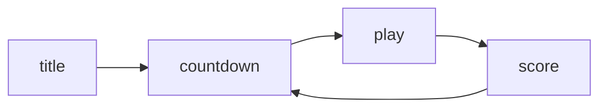

# 状态机

游戏同时在跑标题、倒计时、游戏、结算四套逻辑。用一个字符串变量判断，`main.lua` 会膨胀成一片 `if` 森林。

## 字符串状态的问题

所有状态共享同一个作用域，鸟、管道、分数必须一直存在；拼错状态名不会报错，只是某段逻辑静默不执行。

| 问题     | 字符串变量      | 状态对象          |
| -------- | --------------- | ----------------- |
| 数据归属 | 全在 `main.lua` | 每个状态自己持有  |
| 拼写错误 | 静默失效        | `assert` 立刻报错 |
| 增加状态 | 多一个分支      | 多一个文件        |
| 生命周期 | 全靠 `if` 判断  | `enter` / `exit`  |

## StateMachine

状态机只做三件事：存一张「名字到构造函数」的表、指向当前状态、执行切换。

```lua [StateMachine.lua]
StateMachine = Class{}

function StateMachine:init(states)
    self.empty = {
        enter = function() end, exit = function() end,
        update = function() end, render = function() end
    }
    self.states = states or {}
    self.current = self.empty
end

function StateMachine:change(stateName, enterParams)
    assert(self.states[stateName])
    self.current:exit()
    self.current = self.states[stateName]()
    self.current:enter(enterParams)
end
```

`self.empty` 让还没切换过状态时也能安全调用 `update`，省掉到处判空。`change` 的三步顺序固定：旧状态收尾、新建实例、把参数交给新状态；`exit` 执行时 `self.current` 还是旧状态，不能在里面再调 `change`。

| 方法            | 调用时机       | 该做什么               |
| --------------- | -------------- | ---------------------- |
| `init()`        | 实例化时一次   | 建实体、初始化计时器   |
| `enter(params)` | 每次切入该状态 | 读取上一状态传来的数据 |
| `update(dt)`    | 每帧           | 推进逻辑               |
| `render()`      | 每帧           | 绘制                   |
| `exit()`        | 切走之前       | 收尾                   |

## BaseState 与继承

`BaseState` 提供全套空方法，相当于一份接口契约：任何状态只要补上需要的那几个方法就能工作。

```lua
BaseState = Class{}

function BaseState:init() end
function BaseState:enter() end
function BaseState:update(dt) end
function BaseState:render() end

TitleScreenState = Class{__includes = BaseState}
```

`__includes` 是课程所用 `Class` 库的继承写法：查找方法时先看自己，找不到再去父类找。没有 `exit` 实现时调用落到空函数上，不会报错——空实现的真正价值是把「可选方法」变成「永远可调用」。

## 状态流转与传参

四个状态构成一条闭合回路：



状态表里放的是匿名函数，每次 `change` 都返回全新实例：

```lua
gStateMachine = StateMachine {
    ['title'] = function() return TitleScreenState() end,
    ['countdown'] = function() return CountdownState() end,
    ['play'] = function() return PlayState() end,
    ['score'] = function() return ScoreState() end,
}
```

放函数而不是实例，决定了重开时管道、分数、计时器全部归零；直接存实例，`PlayState` 的 `pipePairs` 会带着上一局的残留继续跑。

传数据靠 `change` 的第二个参数：`gStateMachine:change('score', { score = self.score })`，`ScoreState:enter(params)` 里取 `params.score`。`enter` 每次进入都会跑，所以要能接受空参数：`params = params or {}`。

## 调试与暂停

切状态是最容易出错的地方，在 `change` 开头加一行 `print(('state -> %s'):format(stateName))` 比什么都快；`assert` 的消息写全，拼错时直接看到拼错的值。

暂停别给每个状态加 `paused` 字段，那要写四遍；在 `main.lua` 里拦截 `update`：

```lua
function love.update(dt)
    if paused then
        love.keyboard.keysPressed = {}
        return
    end

    gStateMachine:update(dt)
    love.keyboard.keysPressed = {}
end
```

暂停分支同样要清空输入表，否则暂停期间按下的空格会在恢复那一帧被读到，鸟凭空跳一下。共用逻辑（背景、地面）留在 `main.lua`，包在 `gStateMachine` 调用之外。

字体也是同样的道理：`love.load` 里一次建好 `small`、`medium`、`flappy`、`huge` 四档，标题、倒计时、分数各取所需，`setFont` 只换引用。
