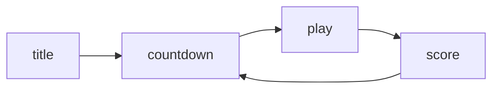

# 状态机

游戏同时在跑标题、倒计时、游戏、结算四套逻辑。如果用一个字符串变量判断，`main.lua` 会迅速膨胀成一片 `if` 森林；状态机把每种状态拆成独立对象，`main.lua` 只剩一句 `gStateMachine:update(dt)`。

## 字符串状态的问题

`if gameState == 'play' then ... elseif gameState == 'title' then ...` 的问题不在写法，而在耦合：所有状态共享同一个作用域，鸟、管道、分数必须一直存在；拼错状态名不会报错，只是某段逻辑静默不执行。

| 问题     | 字符串变量             | 状态对象          |
| -------- | ---------------------- | ----------------- |
| 数据归属 | 全在 `main.lua` 的局部 | 每个状态自己持有  |
| 拼写错误 | 静默失效               | `assert` 立刻报错 |
| 增加状态 | 多一个分支，多一层缩进 | 多一个文件        |
| 复用     | 复制粘贴               | 继承 `BaseState`  |
| 生命周期 | 全靠 `if` 判断         | `enter` / `exit`  |

## StateMachine

状态机只做三件事：存一张「名字到构造函数」的表、指向当前状态、执行切换。

```lua
StateMachine = Class{}

function StateMachine:init(states)
    self.empty = {
        enter = function() end, exit = function() end,
        update = function() end, render = function() end
    }
    self.states = states or {}
    self.current = self.empty
end

function StateMachine:change(stateName, enterParams)
    assert(self.states[stateName])
    self.current:exit()
    self.current = self.states[stateName]()
    self.current:enter(enterParams)
end

function StateMachine:update(dt) self.current:update(dt) end
function StateMachine:render() self.current:render() end
```

`self.empty` 让状态机在还没切换过状态时也能安全调用 `update`，省掉到处判空。`change` 的三步顺序固定：先让旧状态收尾，再新建实例，最后把参数交给新状态。

顺序里有两条隐含约束：`exit` 执行时 `self.current` 还是旧状态，不能在里面再调 `change`；`enter` 里可以安全地读 `self.score` 这类字段，因为实例已经建好。

| 方法            | 调用时机       | 该做什么               |
| --------------- | -------------- | ---------------------- |
| `init()`        | 实例化时一次   | 建实体、初始化计时器   |
| `enter(params)` | 每次切入该状态 | 读取上一状态传来的数据 |
| `update(dt)`    | 每帧           | 推进逻辑               |
| `render()`      | 每帧           | 绘制                   |
| `exit()`        | 切走之前       | 收尾、留需要保存的东西 |

## BaseState 与继承

`BaseState` 提供全套空方法，相当于一份接口契约：任何状态只要补上需要的那几个方法就能工作。

```lua
BaseState = Class{}

function BaseState:init() end
function BaseState:enter() end
function BaseState:update(dt) end
function BaseState:render() end

TitleScreenState = Class{__includes = BaseState}
```

`__includes` 是课程所用 `Class` 库的继承写法：查找方法时先看自己，找不到再去父类找。`TitleScreenState` 因此不用写一堆空函数，只保留 `update` 和 `render`。

没有 `exit` 实现时，调用会落到 `BaseState` 的空函数上，不会报错。这也是空实现的真正价值：它把「可选方法」变成了「永远可调用」。

## 状态流转

四个状态构成一条闭合回路：标题进倒计时，倒计时进游戏，撞死进结算，结算回到倒计时。



状态表里放的是匿名函数，每次 `change` 都返回全新实例：

```lua
gStateMachine = StateMachine {
    ['title'] = function() return TitleScreenState() end,
    ['countdown'] = function() return CountdownState() end,
    ['play'] = function() return PlayState() end,
    ['score'] = function() return ScoreState() end,
}
gStateMachine:change('title')
```

`love.load` 里一次建好 `small`、`medium`、`flappy`、`huge` 四档字体，标题、倒计时、分数各取所需，`setFont` 只是换引用。

放到表里的是函数而不是实例，这一字之差决定了重开一局时管道、分数、计时器全部归零。如果直接存实例，`PlayState` 的 `pipePairs` 会带着上一局的残留继续跑。

## 状态之间传数据

`PlayState` 死亡时把分数交给结算页，靠的是 `change` 的第二个参数：

```lua
gStateMachine:change('score', { score = self.score })
```

`ScoreState:enter(params)` 里取 `params.score` 存到 `self.score`。两个状态互不引用对方的字段，只通过这张表握手；新增字段就是加一个键，不用改状态机。

`enter` 每次进入都会跑，所以要对空参数免疫：`params = params or {}`。从标题页直接切到结算页（调试时常见）不会有参数，少了这行就是 `attempt to index a nil value`。

## 延伸：调试与暂停

切状态是最容易出错的地方，加一行日志比什么都快：

```lua
function StateMachine:change(stateName, enterParams)
    print(('state -> %s'):format(stateName))
    self.current:exit()
    self.current = self.states[stateName]()
    self.current:enter(enterParams)
end
```

`assert` 的消息也值得写清楚：`assert(self.states[stateName], 'unknown state: ' .. tostring(stateName))`，拼错时直接看到拼错的值，比一句 `assertion failed` 省半小时。

- 共用逻辑：背景、地面这类跨状态持续存在的东西留在 `main.lua`，包在 `gStateMachine` 调用之外
- 暂停：给每个状态加 `paused` 字段要写四遍，正确做法是在 `main.lua` 里拦截 `update`
- 输入清理：暂停分支同样要清空 `keysPressed`，否则恢复时有一次幽灵跳

```lua
function love.update(dt)
    if paused then
        love.keyboard.keysPressed = {}
        return
    end

    gStateMachine:update(dt)
    love.keyboard.keysPressed = {}
end
```

暂停分支也要清空输入表，否则暂停期间按下的空格会在恢复那一帧被读到，鸟凭空跳一下。更细的做法是在 `love.focus(focused)` 里失焦自动暂停，避免玩家切窗口回来时鸟已经撞死。

等后面讲 Pokémon 时会用状态栈代替状态机：暂停画面要叠在游戏画面上而不是替换它，那时单层状态机就不够用了。
