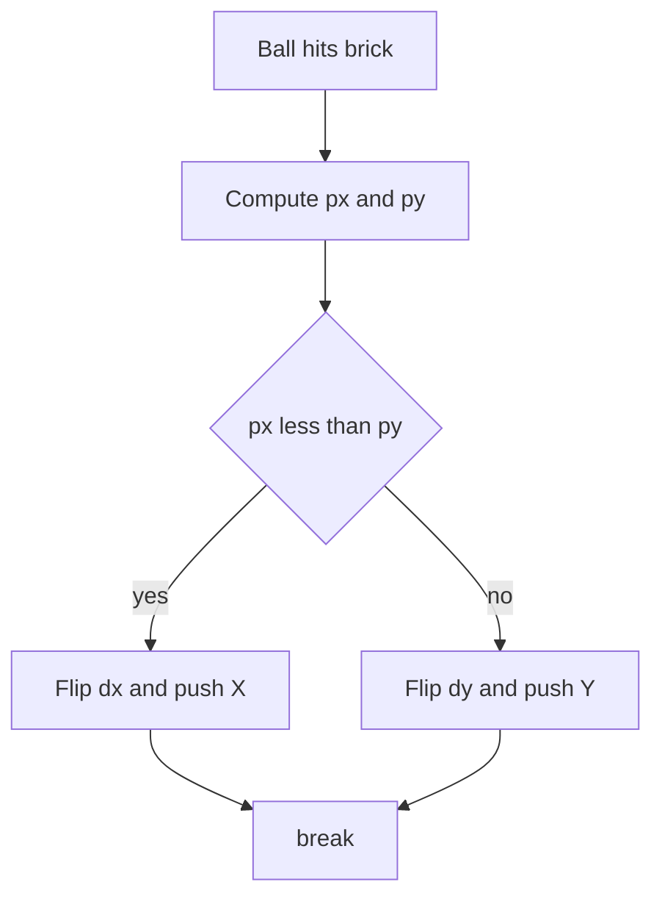

# 碰撞响应

Breakout 的难点不在判断相交，而在决定球从哪一面弹开。

## AABB

矩形相交只做四次比较：只要有一轴完全分开，就不可能重叠。

```lua
function Ball:collides(target)
    if self.x > target.x + target.width
        or target.x > self.x + self.width then
        return false
    end

    if self.y > target.y + target.height
        or target.y > self.y + self.height then
        return false
    end

    return true
end
```

| 条件                         | 含义         |
| ---------------------------- | ------------ |
| `self.x > target.x + width`  | 球在目标右侧 |
| `target.x > self.x + width`  | 球在目标左侧 |
| `self.y > target.y + height` | 球在目标下方 |
| `target.y > self.y + height` | 球在目标上方 |

函数只回答是或否，不回答方向。Pong 只需要左右反弹，Breakout 的砖块四面都能被撞，调用方必须自己补方向判断。

球和挡板都存左上角坐标，`width`、`height` 直接相加就是右边界和下边界。重叠只保证布尔值正确，不保证接触面正确；细长矩形斜着相交时，AABB 会认为碰上了。

## 挡板反弹

挡板只从上方被击中，处理最简单：先把球抬到挡板上沿，再反转 `dy`。不抬的话球会陷进矩形，下一帧继续判定。

```lua
self.ball.y = self.paddle.y - 8
self.ball.dy = -self.ball.dy

local center = self.paddle.x + self.paddle.width / 2

if self.ball.x < center and self.paddle.dx < 0 then
    local offset = center - self.ball.x
    self.ball.dx = -50 - 8 * offset
elseif self.ball.x > center and self.paddle.dx > 0 then
    local offset = self.ball.x - center
    self.ball.dx = 50 + 8 * offset
end
```

| 命中位置 | 挡板状态 | 结果        |
| -------- | -------- | ----------- |
| 左半     | 正在左移 | 向左加速    |
| 右半     | 正在右移 | 向右加速    |
| 其他     | 任意     | 只反转 `dy` |

偏移越大，水平速度越大，球飞得越斜。只有挡板朝着球的方向移动才改 `dx`，否则球会被横向带偏。

`50` 是基础横向速度，`8` 是放大倍数，两个都不是物理量；偏移 20 像素时 `dx` 约 210。`dx` 是直接赋值而不是累加，连续撞同一侧不会越弹越快。

## 砖块四面

砖块可能从上下左右任一方向被撞。课程用中心偏移加穿透深度判断接触面，比写四组边界比较更稳。

```lua
local ox = (brick.x + brick.width / 2) - (self.ball.x + 4)
local oy = (brick.y + brick.height / 2) - (self.ball.y + 4)

local px = brick.width / 2 + 4 - math.abs(ox)
local py = brick.height / 2 + 4 - math.abs(oy)

if px < py then
    self.ball.dx = -self.ball.dx
    self.ball.x = self.ball.x + (ox > 0 and -px or px)
else
    self.ball.dy = -self.ball.dy
    self.ball.y = self.ball.y + (oy > 0 and -py or py)
end
```

`ox`、`oy` 是砖块中心减球中心，符号表示球在砖块的哪一侧。`px`、`py` 是两轴各自重叠的像素数，谁小就说明球从哪个轴先进入。

球宽 8，中心偏移固定写 4；改了球的大小，代码里所有 4 都要同步改。`(ox > 0 and -px or px)` 是 Lua 模拟三元的写法，球心在砖块右侧时取负值。相交时 `px`、`py` 都是非负数，因为只有重叠才会进入这段代码。

| 比较       | 反弹轴 | 推出方向                |
| ---------- | ------ | ----------------------- |
| `px < py`  | X      | `ox` 为正向左，为负向右 |
| `px >= py` | Y      | `oy` 为正向上，为负向下 |

相等时走 `else`，按 Y 轴处理。上下两个面比左右更常见，这个默认值偏向把球弹回场内。



## 加速与单块处理

每命中一块砖，`dy` 乘 1.02，绝对值到 150 就停。没有加速，一局会越拖越久；加速太快，球又会穿过砖块。

```lua
if math.abs(self.ball.dy) < 150 then
    self.ball.dy = self.ball.dy * 1.02
end

break
```

`break` 让一帧只处理一块砖。球压在角落、同时碰到两块时，先命中的那块决定反弹方向；不 break 会连续反转两个轴，球原路返回。

顺序也要注意：先加分、调用 `hit()`、判胜利，再做反弹。1.02 是复利，连撞 30 次后垂直速度接近 1.8 倍；判断放在乘法前，最后一次可能略微超过 150。

## 高速穿透

AABB 只看当前帧的位置。球一帧走 30 像素时，可能从砖块上沿直接跳到下沿。课程的数字刚好安全：`dy` 封顶 150，60 帧下单帧位移约 2.5 像素，远小于 16 像素的砖高。

砖块只有 16 像素高，垂直方向的穿透比水平方向常见。墙面碰撞没有调用 `Ball:collides`，`Ball:update` 直接比较 `x`、`y` 和屏幕边界，因为墙不是矩形对象。

## 调试碰撞

把 `love.graphics.rectangle('line', ...)` 叠在绘制之后，能直接看到碰撞盒和贴图的偏差。球、挡板、砖块都只有 `x`、`y`、`width`、`height` 四个字段，画一个矩形就是全部信息。

更省事的做法是留一个调试开关，统一画所有包围盒；发布时关掉开关，逻辑代码不用改。

- 先画碰撞盒，确认尺寸
- 再打印 `px`、`py`，确认反弹轴
- 最后看 `break` 是否命中多块

调试层不要改任何游戏状态，只读字段。先定位是「没碰上」还是「弹错方向」，再决定看 `collides` 还是看 `px`、`py`。关掉开关后画面必须和原来完全一致，否则问题可能被调试代码掩盖。先复现再改，改完用同一个开关再看一眼。
