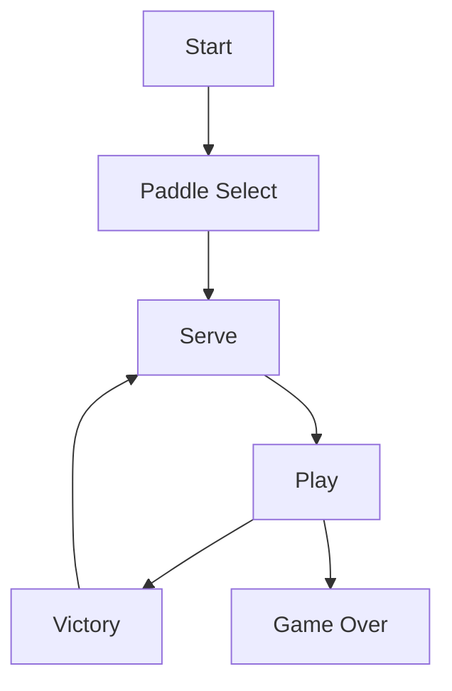

# 状态机

八个界面共用一个 `update` 与 `draw` 入口，状态机负责把每帧调用转发给当前状态。

## 状态表

| 状态               | 进入时机           | 主要去向                        |
| ------------------ | ------------------ | ------------------------------- |
| `start`            | 启动               | `paddle-select`、`high-scores`  |
| `paddle-select`    | 选挡板颜色         | `serve`                         |
| `serve`            | 新球、新关、掉血后 | `play`                          |
| `play`             | 按 Enter 发球      | `serve`、`victory`、`game-over` |
| `victory`          | 砖块清空           | `serve`（下一关）               |
| `game-over`        | 血量归零           | `start`、`enter-high-score`     |
| `high-scores`      | 菜单进入           | `start`                         |
| `enter-high-score` | 分数进榜           | `high-scores`                   |



真正反复循环的只有 `serve` 与 `play`。其余界面都是短暂停留，`start` 是所有路径的公共起点。表里只列主要路径，空格暂停不走状态切换。

Flappy Bird 只有四个状态，Breakout 有八个。分支越多，堆在 `main.lua` 里的 `if state == ...` 越难读，状态机把这种判断换成了表查找。

## 切换协议

```lua
function StateMachine:change(stateName, enterParams)
    assert(self.states[stateName])
    self.current:exit()
    self.current = self.states[stateName]()
    self.current:enter(enterParams)
end
```

`change` 的顺序固定：旧状态 `exit`、目标状态实例化、`enter(params)`。`assert` 让拼错的名字在切换时立刻报错，而不是安静地卡在旧界面。调用方拿不到返回值，失败只表现为抛错，生产代码可以改成先查表再回落 `start`。

状态表里存的是工厂函数：

```lua
gStateMachine = StateMachine {
    ['start'] = function() return StartState() end,
    ['play'] = function() return PlayState() end
}
```

存函数而不是实例，是为了每次切换都得到干净对象。`init` 里的字段随旧实例一起丢弃，界面不会记住上一局的血量。课程里没有任何状态重写 `exit`，旧实例靠 GC 回收。

只有需要手动停循环音效时，`exit` 才值得实现。`enter` 是在 `change` 内部同步调用的，在 `enter` 里再调 `change` 会立刻换掉刚建好的状态，写不好就递归。

## 数据传递

跨状态的数据只能靠 `enterParams`。从 `serve` 进 `play` 时，挡板、砖块、血量、分数、球、关卡号全部塞进一个表：

```lua
gStateMachine:change('play', {
    paddle = self.paddle,
    bricks = self.bricks,
    health = self.health,
    score = self.score,
    ball = self.ball,
    level = self.level
})
```

传的是引用，不是拷贝。挡板在 `serve` 与 `play` 之间是同一个对象，位置能连续；没传的字段不会自动跟过去。

球相反：`ServeState:enter` 每次都新建 `Ball()`，皮肤随机取 1 到 7。`game-over` 只接 `score` 和 `highScores`，少传的代价是回去时必须从 `start` 重来。`highScores` 几乎每个状态都要接，它本质上是全局数据，走 `enterParams` 只是让依赖显式。

## 空状态与基类

```lua
BaseState = Class{}

function BaseState:init() end
function BaseState:enter() end
function BaseState:exit() end
function BaseState:update(dt) end
function BaseState:render() end
```

第一次 `change` 之前，`current` 指向 `empty`，它也有四个空函数。这样 `love.update` 不必判空，启动顺序可以随便排。

子状态写 `Class{__includes = BaseState}`，只覆盖需要的回调，`victory` 没有 `exit`、`high-scores` 没有 `init` 都不报错。`__includes` 只在 metatable 上挂 `__index`，覆盖逐方法生效，字段仍要靠自己的 `init` 建。

## 局部变量的寿命

文件级的 `local` 不随状态实例重建。`StartState.lua` 顶部的 `highlighted` 就是这样，回到菜单时仍停在离开前的高亮项；写在 `init` 或 `enter` 里的字段则每次切换都重置。

`PaddleSelectState.currentPaddle` 放在 `init`，所以每次进界面都从第一个开始。`EnterHighScoreState` 的 `chars` 是文件级 `local`，上一局输过的字母会留到下一次输入框里；想每次从 `AAA` 开始就把它挪进 `enter`。排查状态 bug 时，先看字段写在哪一层。

| 位置             | 寿命     | 例子                   |
| ---------------- | -------- | ---------------------- |
| 文件顶部 `local` | 整个进程 | `highlighted`、`chars` |
| `init` 字段      | 单次实例 | `currentPaddle`        |
| `enter` 字段     | 单次进入 | 传入的 `paddle`        |

新增状态要改三处：写一个继承 `BaseState` 的类、在 `gStateMachine` 的表里注册名字、在 `Dependencies.lua` 里 `require`。漏掉第二步，`change` 会在 `assert` 处停下。

## 暂停

暂停没有新增状态。`PlayState` 用 `self.paused` 标记，暂停时 `update` 提前返回，只保留恢复按键的分支。

这样 `bricks`、`ball`、计时都不用搬进另一个状态，代价是暂停逻辑和主循环挤在一个函数里。暂停期间 `draw` 照常执行，画面停在最后一帧再叠一行 PAUSED。

| 按键     | 状态     | 行为       |
| -------- | -------- | ---------- |
| `space`  | play     | 暂停或恢复 |
| `enter`  | serve    | 发球       |
| `enter`  | victory  | 下一关     |
| `escape` | 多数状态 | 退出       |

暂停键在 `update` 最前面处理，先于球和挡板的移动，否则恢复的那一帧会多走一次位移。

暂停不影响背景音乐，音乐源是全局对象，不归 `PlayState` 管。重新进入 `play` 会新建实例，`paused` 自然是 nil；恢复后球从原来的速度继续，不需要重新发球。

- 暂停只停逻辑
- 音乐继续播放
- 恢复不重置速度

状态机本身没有栈，不能像场景栈那样返回上一层；需要返回的界面只能再 `change` 一次。这个限制换来的是实现只有几十行。
