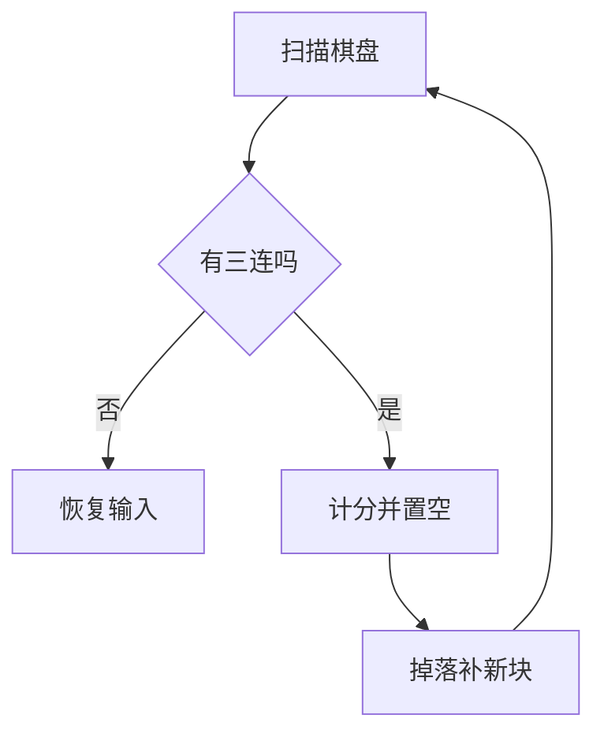

# 消除与连锁掉落

匹配只是找到了三连。真正的乐趣来自后面的连锁：消掉、掉落、又凑成新的三连，一轮轮滚下去。

## 置空与计分

`removeMatches` 按 `matches` 里每个 `Tile` 的 `gridX`/`gridY`，把 `tiles` 对应位置设成 `nil`。没有额外的「死亡」标记，`nil` 本身就是空位。

置空之前先结算分数，因为一置空就再也拿不到那组方块的长度了。计分放在 `PlayState` 而不是 `Board`，棋盘只负责「哪些格子空了」。

## 从下往上补洞

`getFallingTiles` 逐列处理，方向是从底往上。维护两个局部变量：`space` 表示这一列里已经遇到过空格，`spaceY` 记住最下面那个空位。

```lua
local y = 8
while y >= 1 do
    local tile = self.tiles[y][x]

    if space then
        if tile then
            self.tiles[spaceY][x] = tile
            tile.gridY = spaceY
            self.tiles[y][x] = nil

            tweens[tile] = { y = (tile.gridY - 1) * 32 }

            space = false
            y = spaceY          -- 回到落点继续往上找
            spaceY = 0
        end
    elseif tile == nil then
        space = true
        if spaceY == 0 then spaceY = y end
    end

    y = y - 1
end
```

关键在 `y = spaceY` 这一行。把上方方块搬到 `spaceY` 后，`spaceY` 那一格被填上了，但它上面到原位置之间还可能有洞，所以从落点重新往上扫一遍。少了这一步，一列里有两个不相邻空洞时只会补上第一个。

函数不自己启动动画，只返回一张 `tweens` 表：key 是 `Tile` 对象，value 是目标像素坐标。`Board` 负责数据，`PlayState` 负责表现，两边通过这张表交接。

旧块下移和新块入场也写进同一张表，所以一次 `Timer.tween(0.25, ...)` 就能让两者同步落位。

## 新块从天花板进场

搬完已有的方块，每列顶部还会剩下若干 `nil`。这里另起一轮循环，从下往上为每个空位生成新 `Tile`，并把初始 `tile.y` 设成 `-32`——正好在棋盘上方一格，屏幕外。

新块的 `gridX`/`gridY` 已经是最终落位，只有像素 `y` 在屏幕外。补间把 `y` 拉回 `(gridY - 1) * 32`，观感上就是从天花板掉下来。数据先落位、画面后追上，这个拆分贯穿整个掉落流程。

| 阶段     | 谁改              | 何时完成       |
| -------- | ----------------- | -------------- |
| 逻辑落位 | `getFallingTiles` | 调用时立刻完成 |
| 像素移动 | `Timer.tween`     | 0.25 秒后      |

所以在这 0.25 秒里，棋盘数据已经是最终状态，玩家看到的只是延迟播出的动画。

## 递归直到稳定

`PlayState:calculateMatches` 在补间结束时再调自己一遍：



函数命中就移除、掉落、补新块，然后 `:finish` 里递归；没有新匹配时才把 `canInput` 置回 `true`。注意这道锁只被写成 `true`，从来没有被写成 `false`，所以连锁期间输入其实没被挡住——这是个抄代码时容易一起抄进去的缺口。

递归没有深度上限。理论上随机生成的新块可以无限续下去，实际概率随波数指数下降，但这也是个真实风险：如果掉落逻辑写错（比如某列始终填不满），这里会变成死循环而不是报错。稳妥的写法是加一个波数上限，超过就强制重排棋盘。

## 为什么按列处理

方块只沿 Y 轴下落，横向不会移动，所以八列互不影响。这让问题从「整盘重排」退化成八个独立的一维压缩，每列扫一遍就完事。

| 阶段     | 一列从上到下的内容    |
| -------- | --------------------- |
| 消除后   | `A` 空 `B` 空 `C`     |
| 搬运后   | 空 空 `A` `B` `C`     |
| 补新块后 | `N1` `N2` `A` `B` `C` |

搬运保持了原有相对顺序：`A` 仍在 `B` 上面。这一点不是巧合，从底往上扫、遇到洞就把它上面的方块拉下来，天然稳定。用排序或反复冒泡也能得到同样结果，代价是多几个数量级的比较。

列优先还有一层好处：新块生成也能按列计数。哪一列缺几格，就在这一列的顶部循环几次，不用维护全局的「剩余空位数」。

## 补间表用 Tile 当 key

`tweens` 写成 `[tile] = { y = 目标 }` 而不是数组，因为 `Timer.tween` 的定义表本来就以对象为 key，`getFallingTiles()` 的返回值可以直接喂进去：

```lua
Timer.tween(0.25, self.board:getFallingTiles()):finish(function()
    self:calculateMatches()
end)
```
