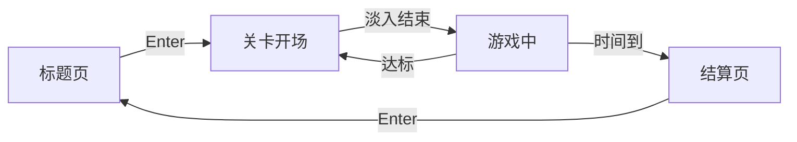

# 状态机与过渡

四个状态各管一摊，切换只有一条路径：`exit` 旧实例、新建实例、`enter` 新实例。

## 结构

`BaseState` 声明 `enter`/`update`/`render`/`exit` 四个空方法当契约。`StateMachine` 的 `states` 表存的不是实例，而是返回实例的工厂函数：

```lua
function StateMachine:change(stateName, enterParams)
    assert(self.states[stateName])
    self.current:exit()
    self.current = self.states[stateName]()
    self.current:enter(enterParams)
end
```

每次切换都拿到全新实例，字段不会从上一关残留。代价是必须靠 `enter(params)` 把需要延续的东西显式带过去，例如分数和关卡号。

`init` 里预置了一个 `empty` 状态，四个方法都是空函数。它让第一帧的 `update`/`render` 有东西可调，省掉一堆 `if self.current`。

## 四条主线



| 状态         | `enter` 收到什么          | 出口                  |
| ------------ | ------------------------- | --------------------- |
| `start`      | 无                        | 淡出后进 `begin-game` |
| `begin-game` | `level`、可选 `score`     | 标题播完进 `play`     |
| `play`       | `level`、`score`、`board` | 达标或超时            |
| `game-over`  | `score`                   | Enter 回 `start`      |

`play` 接收 `board` 是为了复用：棋盘在 `begin-game` 里就已经建好并画在屏幕上，如果 `play` 自己再 `Board(...)`，开场那两秒看到的棋盘和真正开始时的不一样，玩家会看到方块整体换了一遍。

## 全屏白矩形

引擎没有「渐变到白色」的接口，做法是在最上层铺一个白色矩形，补间它的透明度。

- `start` 里 `transitionAlpha` 从 0 补到 1，`:finish` 里才 `change('begin-game')`
- `begin-game` 的 `transitionAlpha` 从 1 开始，立刻补到 0

```lua
Timer.tween(1, {
    [self] = { transitionAlpha = 1 }
}):finish(function()
    gStateMachine:change('begin-game', { level = 1 })
    self.colorTimer:remove()
end)
```

状态切换发生在全白那一帧，玩家看不到任何突变。所谓「平滑过渡」并没有让切换本身变平滑，只是把观众的注意力挡在了一面白墙后面。

淡出期间必须屏蔽输入。`StartState` 用 `pauseInput` 标记锁住 1 秒，否则玩家连按 Enter 会在补间还没结束时重复创建计时器。`PlayState` 里也留了 `canInput`，但它只被写成 `true`、从没被写成 `false`，等于没锁。

## 关卡标题的时间线

`begin-game` 是这一讲最像「编排」的代码。四段串起来，全靠 `:finish` 和 `Timer.after`：

| 顺序 | 时长    | 动作                      |
| ---- | ------- | ------------------------- |
| 1    | 1.0 秒  | 白幕淡出，棋盘露出        |
| 2    | 0.25 秒 | 标题从 `-64` 移到屏幕中央 |
| 3    | 1.0 秒  | 停顿，标题留在中央        |
| 4    | 0.25 秒 | 标题移出下边缘            |

第 3 段用 `Timer.after(1, ...)` 而不是补间，因为它没有要动的值——只想要一个「等一会儿」的占位符。补间描述变化，`after` 描述等待，两者混用没问题。

第 4 段结束后才 `change('play', ...)`。整段没有一行手写的插值数学，全是声明。

## 参数、计时器与共享资源

分数通过 `params` 逐棒传递，`enter` 里用 `params.score or 0` 兜默认值。关卡号同理，`level + 1` 在切换时算好。

```lua
function PlayState:enter(params)
    self.level = params.level
    self.score = params.score or 0
    self.scoreGoal = self.level * 1.25 * 1000
end
```

计时器的生命周期比分数的短得多，因此必须在切换前 `Timer.clear()`。规范是：**先清、再切**。反过来写，新状态在 `init` 里注册的倒计时会被一起清掉，症状是「进入关卡但没有计时」，而且不报错。

状态只持有「这一屏自己的东西」：光标位置、选中方块、本关分数、本关时间。跨状态共享的资源全部上移：

| 内容                        | 位置               | 理由                     |
| --------------------------- | ------------------ | ------------------------ |
| `gTextures` `gSounds`       | `Dependencies.lua` | 加载一次，状态轮换不重读 |
| `gFonts`                    | `Dependencies.lua` | 字体对象重复创建很贵     |
| 背景滚动偏移                | `main.lua`         | 四个状态共用同一张背景   |
| `love.keyboard.keysPressed` | `main.lua`         | 输入缓冲必须全局唯一     |

`Dependencies.lua` 在这里的作用等价于一个极简的服务容器：把「谁都能用」的东西收进一个文件，状态文件就只剩游戏逻辑。少了它，每个状态开头都会有一串 `require` 和资源路径。

`game-over` 是这一版唯一没有过渡的状态，时间一到立刻硬切。想补上只需在同一套机制里再放一个 `transitionAlpha`，把 `change` 挪进 `:finish`。
