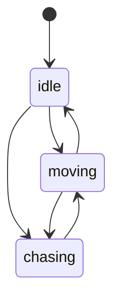

# 敌人 AI

蜗牛只有三个状态，却已经有巡逻、追踪和停下的感觉；关键在于距离判断和脚下的地形检查。

## 三态分工

`idle` 原地等待，`moving` 随机巡逻，`chasing` 朝玩家移动。三者共享同一个移动速度和同一套地块查询，差别只在往哪走、什么时候停；三个状态都不处理重力，蜗牛永远贴地。

| 状态      | 动画         | 行为           | 转移                                   |
| --------- | ------------ | -------------- | -------------------------------------- |
| `idle`    | 第 51 帧     | 原地等待       | 超时到 `moving`，玩家靠近到 `chasing`  |
| `moving`  | 第 49、50 帧 | 随机方向走一段 | 超时随机停或换向，玩家靠近到 `chasing` |
| `chasing` | 第 49、50 帧 | 朝玩家走       | 距离超过 5 格回 `moving`               |



`idle` 的等待时长由 `changeState('idle', { wait = math.random(5) })` 传入，在 `enter` 里取出存成 `waitPeriod`。状态实例每次切换都重建，计时器自然归零。巡逻方向每段重新随机。

`moving` 与 `chasing` 用同一套动画，玩家只能靠移动方向区分。`moving` 的时长和方向都随机，巡逻路径每局不同。状态切换即重置计时器。

## 距离感知

只用 X 轴距离，不做欧氏距离，也没有视线检测。感知只在水平方向比较。

```lua
local diffX = math.abs(self.player.x - self.snail.x)

if diffX > 5 * TILE_SIZE then
    self.snail:changeState('moving')
elseif self.player.x < self.snail.x then
    self.snail.direction = 'left'
    self.snail.x = self.snail.x - SNAIL_MOVE_SPEED * dt
else
    self.snail.direction = 'right'
    self.snail.x = self.snail.x + SNAIL_MOVE_SPEED * dt
end
```

5 格是 80 像素，玩家必须走到比较近的位置才会被盯上。追踪时蜗牛直接朝玩家的 X 移动，玩家跳跃或站上柱子都不会改变判断。

只看 X 轴还有一个副作用：玩家站在蜗牛正上方的高台上也会被追。要修，就在距离判断里加一条 `math.abs(player.y - snail.y) < 2 * TILE_SIZE`。距离用像素比较，换算成格子要乘 `TILE_SIZE`。

## 边缘与撞墙

移动后查两个格子：正前方是否有墙，脚下方是否有地。任一成立就退回原位，`moving` 状态还会换向，先移动再判定。

```lua
local tileRight = tilemap:pointToTile(x + width, y)
local tileBottomRight = tilemap:pointToTile(x + width, y + height)

if (tileRight and tileBottomRight)
    and (tileRight:collidable()
         or not tileBottomRight:collidable()) then
    self.snail.x = self.snail.x - SNAIL_MOVE_SPEED * dt
end
```

必须先判 `nil`：地图边界外 `pointToTile` 返回 `nil`，直接调用 `:collidable()` 会崩。蜗牛因此不会走下平台，也不会穿墙，但它同样不会绕路。

判定用的是移动后的位置，所以顺序是先移动再检查。掉进坑里的敌人不会死，因为边缘检测让它根本不会走下去。两格任一缺失就跳过修正。

## 踩踏与死亡

踩踏判定写在玩家的 `falling` 状态里，不比较 `dy`，只看两个矩形是否重叠。

```lua
for k, entity in pairs(level.entities) do
    if entity:collides(player) then
        player.score = player.score + 100
        table.remove(level.entities, k)
    end
end
```

在下落状态碰到敌人就算踩死，`idle`、`walking`、`jump` 状态碰到同一批实体会重开关卡。跳到最高点前侧撞会死，下落时侧撞反而算踩，这是状态写的判定带来的细节。踩死敌人奖励 100 分。

删除时倒序遍历，避免 `pairs` 跳过元素。

## 生成与朝向

蜗牛在 `PlayState` 里生成，不在 `LevelMaker`。每列从上往下找第一个地面格，1/20 概率在该列放一只。生成概率按列独立判定。

| 参数     | 值     | 说明         |
| -------- | ------ | ------------ |
| 生成概率 | 1/20   | 每列独立判定 |
| 尺寸     | 16×16  | 与地块同高   |
| 初始状态 | `idle` | 等待随机秒数 |
| 移动速度 | 10     | 比玩家慢很多 |

100 列的关卡平均五只，密度不高。敌人多起来后，每只每帧只做两三次 `pointToTile`，开销仍然很小。生成时没有再检查该格是否已被占用，同一列只会放一只。

蜗牛的翻转写法和玩家相反：`direction == 'left'` 取 1，`right` 取 -1，说明素材默认朝左。照抄玩家的表达式会画反，换素材后先看默认面向哪边。

## 调参与局限

蜗牛速度 10，玩家速度 60，追逐其实追不上。它的作用是逼玩家改变路线，而不是真的造成威胁；速度一旦接近玩家，关卡就变成逃跑游戏。速度差决定玩家的反应时间。

5 格边界会让蜗牛在临界点反复切换：玩家退一步它回 `moving`，再进一步又 `chasing`。加一个更远的退出阈值（进入 5 格、退出 7 格）就能消除抖动。退出阈值必须比进入阈值大，所有阈值写成常量，调起来不用翻文件。

调 AI 时按这个顺序：

- 定巡逻速度
- 定感知距离
- 加进入与退出阈值
- 检查悬崖与墙
- 最后调生成密度
