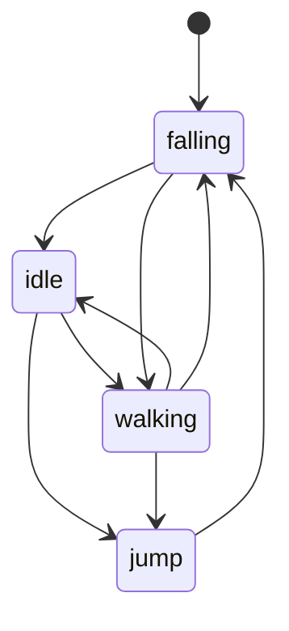

# 实体与状态机

玩家和敌人都在动，但它们的「动」分几种情况；把这些情况拆成状态，比在一个 `update` 里堆布尔量更好维护。

## Entity 基类

`Entity` 只保存所有会动的对象共有的字段，并把行为委托给状态机。

```lua
function Entity:init(def)
    self.x, self.y = def.x, def.y
    self.dx, self.dy = 0, 0
    self.width, self.height = def.width, def.height
    self.texture = def.texture
    self.stateMachine = def.stateMachine
    self.direction = 'left'
    self.map = def.map
    self.level = def.level
end
```

`map` 用来查地块，`level` 用来查其他实体和游戏对象。两个引用让实体不必依赖全局变量，也让同一套类能放进不同关卡。实体类只保存数据并转发行为，实体间碰撞用 `Entity:collides` 的 AABB。

`Entity:update` 只有一行：`self.stateMachine:update(dt)`。`direction` 默认 `left`，创建后由第一个状态或输入改写。

## StateMachine

状态表存的是工厂函数，不是实例；切换时先退出旧状态，再新建、进入新状态。

```lua
function StateMachine:change(stateName, enterParams)
    assert(self.states[stateName])
    self.current:exit()
    self.current = self.states[stateName]()
    self.current:enter(enterParams)
end
```

表里放函数，是因为每个状态要绑定自己的实体，实例化时才能把 `player` 传进去。每次切换重建实例，顺带重置计时器和动画。状态机初始化时用 `empty` 占位，第一次切换前也能安全更新。

`assert` 让拼错的状态名立刻报错，而不是查表得到 `nil` 后静默失效。状态名是字符串，改名要全局搜索。状态机只负责分发，不保存业务数据。

## 玩家的四个状态

| 状态      | 进入条件       | 动画         | 更新行为         |
| --------- | -------------- | ------------ | ---------------- |
| `idle`    | 落地且无方向键 | 第 1 帧      | 响应方向键与空格 |
| `walking` | 按左右         | 第 10、11 帧 | 平移并做侧向碰撞 |
| `jump`    | 空格，速度为负 | 第 3 帧      | 施加重力，查头顶 |
| `falling` | `dy >= 0`      | 第 3 帧      | 查脚下、踩敌人   |



`walking` 每帧检查脚下两个格子，都没有可站立的地块就切 `falling`。没有这条转移，角色会悬空走过平台边缘。

状态表就是转移图，表里没有的组合不会发生。`falling` 落地后按输入回到 `idle` 或 `walking`，所以一次跳跃的完整路径是确定的。

落地当帧就按输入直接切走；晚一帧切会让角色闪一下 `idle` 动画，手感发滞。

一次跳跃会经过：

- `idle` 或 `walking` 按空格进 `jump`
- 上升到顶点转 `falling`
- 落地按输入回 `idle` 或 `walking`
- 撞头提前转 `falling`

## 状态类的写法

每个状态一个文件，继承 `BaseState`，在 `init` 里设置动画，在 `update` 里读输入。

```lua
function PlayerIdleState:init(player)
    self.player = player
    self.player.currentAnimation =
        Animation { frames = {1}, interval = 1 }
end

function PlayerIdleState:update(dt)
    if love.keyboard.isDown('left')
        or love.keyboard.isDown('right') then
        self.player:changeState('walking')
    end

    if love.keyboard.wasPressed('space') then
        self.player:changeState('jump')
    end
end
```

`BaseState` 只提供空的 `update`、`render`、`enter`、`exit`，状态类按需覆盖。`enter` 适合放音效和初始速度，`exit` 适合清理计时器。状态文件只持有引用，不复制数据。

新增状态时按顺序接入：

- 建文件并继承 `BaseState`
- 在 `init` 里绑定实体
- 写转移条件
- 在状态表登记工厂函数
- 从旧状态加一条转移

## 进入参数与工厂函数

`changeState` 的第二个参数只在 `enter` 时读一次，之后存到字段里。

```lua
snail:changeState('idle', { wait = math.random(5) })

function SnailIdleState:enter(params)
    self.waitPeriod = params.wait
end
```

不要在 `update` 里反复从状态机取参数：参数属于进入的那一刻，状态自己保存才准确。参数是表，可以带多个字段，不必改函数签名。参数名与字段名不必相同。

蜗牛的状态还要读玩家坐标。构造状态时把 `player` 引用传进去，状态只存引用，不复制位置。

`PlayState` 构造玩家时，状态表里的闭包已经引用了 `self.player`，但那时 `player` 还没赋值。闭包延迟到 `changeState` 时才求值，所以不报错；若把状态表换成实例，构造顺序就会死锁，工厂函数正是为了解决这个问题。

## 两类状态机与边界

| 维度     | 游戏状态                  | 实体状态           |
| -------- | ------------------------- | ------------------ |
| 持有者   | 全局 `gStateMachine`      | 每个实体自己       |
| 状态类   | `StartState`、`PlayState` | 玩家、蜗牛的状态类 |
| 切换参数 | 基本不用                  | 等待时长、重力     |
| 渲染范围 | 整个场景                  | 一个精灵           |

两者共用同一个 `StateMachine` 实现，区别只在状态类做什么。游戏状态管场景切换，实体状态管对象行为；把两者混在一起，会出现暂停时敌人还在走之类的 bug。每个状态只关心自己那一帧的行为。

状态持有实体引用，不复制实体的数据。所有状态读写同一份 `x`、`dy`，切换后位置连续，不会瞬移。

`update` 负责副作用，`render` 只读。渲染函数里不要切换状态或改位置，否则暂停、重绘、截图都会意外推进游戏。暂停时跳过 `update` 即可，实体渲染只有一处 `draw` 调用，状态类共享动画常量。
