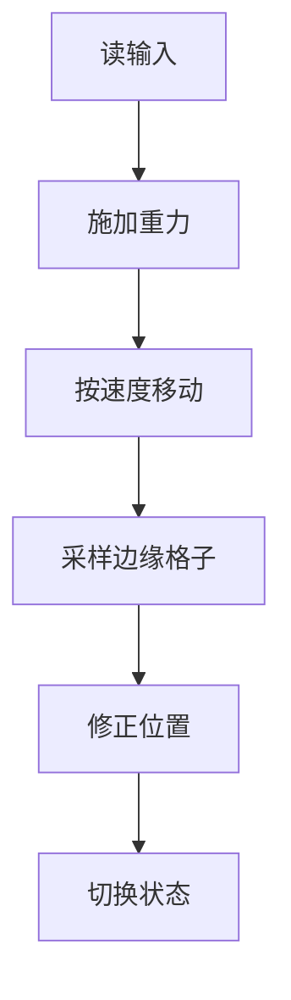

# 重力与平台碰撞

平台游戏的手感来自两个数：每帧累加的重力，和只在落地时允许触发的跳跃。

## 速度积分

每帧先给 `dy` 加重力，再用 `dy` 改位置。顺序反了，起跳第一帧就没有速度；一帧只积分一次。

```lua
player.dy = player.dy + GRAVITY * dt
player.y = player.y + player.dy * dt
```

Y 轴向下为正，所以起跳速度是负数。`-300` 除以 `900` 得到上升时间约 0.33 秒，来回滞空约 0.67 秒。先加再乘与先乘再加，结果差一帧的重力。

| 常量                   | 值   | 作用               |
| ---------------------- | ---- | ------------------ |
| `TILE_SIZE`            | 16   | 格子边长           |
| `GRAVITY`              | 900  | 每秒增加的下落速度 |
| `PLAYER_JUMP_VELOCITY` | -300 | 起跳初速度         |
| `PLAYER_WALK_SPEED`    | 60   | 水平移动速度       |

## 跳跃的触发条件

跳跃只在 `idle` 或 `walking` 状态响应空格，`wasPressed` 保证按住不会连跳。

```lua
if love.keyboard.wasPressed('space') then
    self.player:changeState('jump')
end

function PlayerJumpState:enter(params)
    gSounds['jump']:play()
    self.player.dy = PLAYER_JUMP_VELOCITY
end
```

`enter` 里赋速度，`update` 里只做积分。`dy >= 0` 时上升结束，切到 `falling`，两个状态共用同一帧动画。`enter` 只执行一次，按住不会重复触发。

用 `dy == 0` 判断落地并不可靠：跳到最高点时 `dy` 也接近 0。改成状态判断后，只有真正站在地面上的状态才接受起跳，状态判断比数值判断稳。

## 点采样代替 AABB

地图是静态网格，不必对每个 tile 做 AABB。把角色边缘的像素坐标除以 `TILE_SIZE`，直接取出那一个格子。只查角色周围，开销固定。

```lua
local tileBottomLeft = map:pointToTile(x + 1, y + height)
local tileBottomRight = map:pointToTile(x + width - 1, y + height)
```

| 方向 | 采样位置     | 用途           |
| ---- | ------------ | -------------- |
| 头顶 | 左右上角各一 | 撞块、进洞     |
| 脚下 | 左右下角各一 | 落地、走出边缘 |
| 左侧 | 左上与左下   | 向左卡墙       |
| 右侧 | 右上与右下   | 向右卡墙       |



左右各取一点，因为角色可能横跨两个格子：只查左边，右半边会陷进墙里。每个方向两个点，一帧最多四次查询。采样点都在精灵内部。

两个点都不可站立才算悬空，所以脚下判断要同时看左右。两个点正好覆盖角色宽度。

## 位置修正

碰撞后不能只把速度清零，还要把角色推回格子外，否则下一帧仍然重叠。

```lua
if tileLeft:collidable() or tileRight:collidable() then
    player.dy = 0
    player.y = (tileLeft.y - 1) * TILE_SIZE - player.height
end
```

`tile.y` 是行号，从 1 开始；乘 `TILE_SIZE` 前减一，才是格子上边缘的像素坐标。再减角色高度，让脚底正好贴上边缘。

侧向同理，用 `tile.x` 反推：向左撞墙时 `x = (tile.x - 1) * TILE_SIZE + tile.width`。撞地面改 `y` 和 `dy`，撞墙只改 `x`。修正用格子坐标，不用速度反推，两轴一起改会把角色弹飞。

走路时脚底贴着砖块顶面，侧向采样会把脚下的砖当成墙。检查左右前先把 `y` 减 1，查完再加回去；跳跃与下落状态不做这个偏移。

## 手感调整

初速度和重力决定最大跳高：`h = v² / (2g)`，代入 `300² / (2 × 900)` 得到 50 像素，约 3 格。这决定了砖块能放在哪：离地超过三格就顶不到。公式假设初速与重力恒定。

| 参数     | 调大     | 调小 |
| -------- | -------- | ---- |
| 重力     | 下落更快 | 更飘 |
| 跳跃初速 | 跳更高   | 更矮 |
| 水平速度 | 跑更快   | 更稳 |

按住空格跳得高、轻点跳得矮，是常见的手感补丁。在上升阶段松开按键时截断速度即可。

```lua
function love.keyreleased(key)
    if key == 'space' and player.dy < 0 then
        player.dy = player.dy * 0.5
    end
end
```

只在 `keyreleased` 里截断一次，不能写在 `update` 里，否则按住不放时每帧都在减速。截断比例越小，轻点跳得越矮，截断只发生一次。这段逻辑只处理上升期。

## 边界情况

课件没有给下落速度设上限，`dy` 会一直增大。单帧位移超过 16 像素后，点采样可能从墙的一侧跳到另一侧，直接穿过薄地板。终端速度能防穿透。

补法是限制最大 `dy`，或把一帧拆成多个子步，每步位移不超过 `TILE_SIZE / 2`。单向平台还要在 `dy > 0` 时判定，并要求移动前的脚底在平台顶面之上。累加器要限制补帧次数。

`dt` 随帧率波动，同一段跳跃在不同机器上高度会略有差异。固定成 1/60 秒的物理步长，结果就稳定了，也顺带解决高速穿透；渲染仍按真实时间。

地图下方没有地板。`y` 超过 `VIRTUAL_HEIGHT` 就切回 `start`，不用等落地，这是坠落判定。

- 采样点落在精灵内
- 格子里有 tile
- `collidable` 返回真
- 只改一个轴
- 清零对应速度
- 最后切状态
