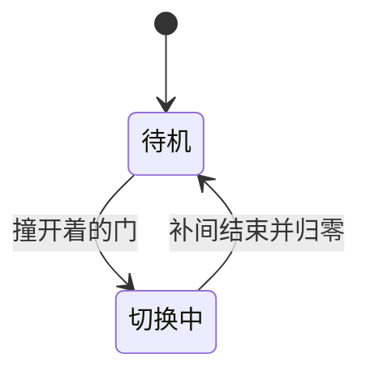

# 相机与房间切换

## 相机只是个偏移

`Dungeon` 持有 `cameraX`、`cameraY`，渲染时喂给 `love.graphics.translate`。平时它们是 0，只有切换时才非零。

```lua
function Dungeon:render()
    if self.shifting then
        love.graphics.translate(-math.floor(self.cameraX),
                                -math.floor(self.cameraY))
    end
    self.currentRoom:render()
    if self.nextRoom then
        self.nextRoom:render()
    end
end
```

`PlayState` 用 `love.graphics.push()` / `pop()` 把这段平移包起来，否则血条和调试地图也会跟着飘走。平移量取整是为了避开浮点采样造成的接缝，整数像素平移不会糊边。

## 事件触发位移

门的碰撞发生在玩家走路状态里，但它不该直接操作相机。走路状态只广播一个字符串，`Dungeon` 在构造时注册四个监听。

```lua
Event.on('shift-left',  function() self:beginShifting(-VIRTUAL_WIDTH, 0) end)
Event.on('shift-right', function() self:beginShifting(VIRTUAL_WIDTH, 0) end)
Event.on('shift-up',    function() self:beginShifting(0, -VIRTUAL_HEIGHT) end)
Event.on('shift-down',  function() self:beginShifting(0, VIRTUAL_HEIGHT) end)
```

位移量正好是一屏，因为相邻房间在概念上就摆在这一屏之外。`beginShifting` 先置 `shifting = true`，这个标志会挡住整间房的更新，避免玩家在半空中继续走。

| 事件          | 位移              | 下一间房坐标 |
| ------------- | ----------------- | ------------ |
| `shift-left`  | `-VIRTUAL_WIDTH`  | `x - 1`      |
| `shift-right` | `+VIRTUAL_WIDTH`  | `x + 1`      |
| `shift-up`    | `-VIRTUAL_HEIGHT` | `y - 1`      |
| `shift-down`  | `+VIRTUAL_HEIGHT` | `y + 1`      |

## 补间与收尾

相机和玩家用同一个 `Timer.tween` 补，时长 1 秒，因此人走多快完全由时长决定，与走路速度无关。

```lua
Timer.tween(1, {
    [self]        = { cameraX = shiftX, cameraY = shiftY },
    [self.player] = { x = playerX, y = playerY }
}):finish(function()
    self:finishShifting()
    -- 把玩家放回新房间对应门口，重设 direction
end)
```

`finishShifting` 做四件事：相机归零、`shifting` 复位、`currentRoom` 指向 `nextRoom`、`nextRoom` 置空。房间的 `adjacentOffsetX/Y` 也在这时清零，否则新房间会一直画在屏幕外。



## 玩家也被补间

相机在动，玩家也得跟着走，否则人会在原地等画面滑过去。目标坐标是先算出"下一间房里对应的门口"，再加上一整屏的偏移，所以补间过程中人其实在屏幕外。

| 方向    | 补间目标 `x` / `y`                                  |
| ------- | --------------------------------------------------- |
| `right` | `VIRTUAL_WIDTH + MAP_RENDER_OFFSET_X + TILE_SIZE`   |
| `left`  | `-VIRTUAL_WIDTH + 地图右端 - 玩家宽`                |
| `down`  | `VIRTUAL_HEIGHT + MAP_RENDER_OFFSET_Y + 玩家高 / 2` |
| `up`    | `-VIRTUAL_HEIGHT + 地图底端 - 玩家高`               |

补间结束后再把坐标减掉那一屏，人就落在新房间门口，同时把 `direction` 改成进门方向。两个动作必须原子完成，否则会闪一帧。

`Event.dispatch` 是同步调用，回调里直接启动 tween，所以撞门那一帧就已经进入切换状态。tween 本身靠全局 `love.update` 里的 `Timer.update(dt)` 推进，漏掉那一行，相机就永远停在原地。

## 两间房同时存在

切换期间，`nextRoom` 被赋值为目标房间，并设上 `adjacentOffsetX = shiftX`。它的所有格子与实体都会加上这个偏移绘制，正好落在屏幕外侧一屏的位置。

- 当前房间照常画在原点
- 下一间房画在偏移后的位置，随相机一起滑入
- `Room:update` 开头判断 `adjacentOffsetX ~= 0` 就直接返回，屏幕外那间不动
- 进入下一间房前，先把它的门全部设为打开，让人能走进去

玩家的绘制不接收偏移参数，所以它由 tween 直接改 `x`、`y`，而不是靠父级平移。

实体则相反。`Entity:render(offsetX, offsetY)` 会先把 `x`、`y` 加上偏移、画完再减回去，因为状态里的绘制代码只认 `entity.x`。这种临时挪坐标的写法省掉了一次坐标传递，但要求加减严格配对。

切换本质是传送：玩家在旧房间贴着门，1 秒后坐标被硬设到新房间另一侧，方向一起改，「走过去」只是补间在骗眼睛。

- `shifting` 期间只更新动画、不跑状态机，按键完全无效，这是有意的输入锁
- 1 秒是够看清又不烦的折中；0.3 秒利落，2 秒像卡住
- tween 被其他 tween 打断时 `finishShifting` 不会执行，`shifting` 永久为真，游戏就此卡死
- 结束时必须关掉旧房间的门、复位开关，否则回去时门还开着
