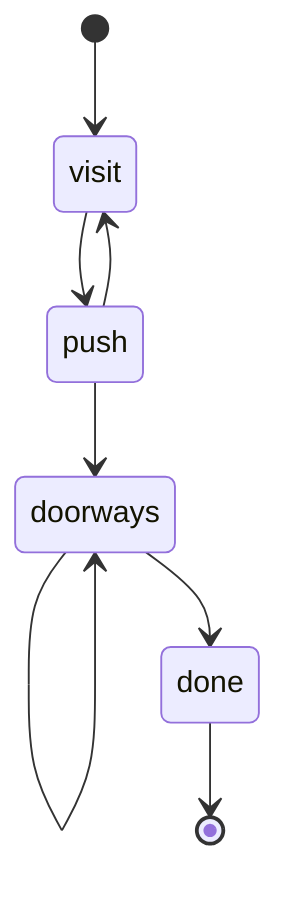

# 地牢生成与协程

地牢不是手工摆的关卡，而是从一格起点出发、按队列向四周长出来的连通图。生成过程用协程切成小步，好在屏幕上一步一步看。

## 队列怎么爬

十乘十的网格里全是 `false`，从底部中央 `(5, 10)` 入队。`head` 指向下一个要处理的格子，`visited` 用 `"x,y"` 字符串记录已入队的坐标。

```lua
local queue = { { x = startX, y = startY } }
local head = 1
local visited = { [startX .. ',' .. startY] = true }
local numRooms = 0

while head <= #queue and numRooms < maxRooms do
    local current = queue[head]
    head = head + 1
    local cx, cy = current.x, current.y

    if not rooms[cy][cx] then
        rooms[cy][cx] = Room(player, cx, cy)
        numRooms = numRooms + 1
    end
    visited[cx .. ',' .. cy] = true
    -- 洗牌后逐个方向尝试入队
end
```

`head` 只增不减，出队就是移动下标，`queue` 从头到尾都不删元素。这是 Lua 里最省的队列写法，代价是数组会一直长到最后访问过的节点数。

关键细节：`visited` 在**入队时**就置真，不是出队时。否则两个相邻房间会同时把同一个空格子塞进队列，同一格被重复处理，空跑一圈。

| 变量       | 作用                   |
| ---------- | ---------------------- |
| `queue`    | 待处理坐标，只追加     |
| `head`     | 下一个要读的下标       |
| `visited`  | 已入队坐标，防重复     |
| `numRooms` | 已建房间数，封顶       |
| `rooms`    | 二维表，`false` 表示空 |

## 四个方向的取舍

每个节点都把方向数组洗牌，然后依次尝试上下左右。每个方向有 40% 概率被跳过，剩下 60% 才检查越界与 `visited`。

```lua
local directions = {'up', 'down', 'left', 'right'}
for i = #directions, 2, -1 do
    local j = math.random(i)
    directions[i], directions[j] = directions[j], directions[i]
end

for _, dir in ipairs(directions) do
    if math.random() < 0.4 then goto continue end
    local nx, ny = cx, cy
    if dir == 'up' then ny = ny - 1
    elseif dir == 'down' then ny = ny + 1
    elseif dir == 'left' then nx = nx - 1
    else nx = nx + 1 end
    if nx >= 1 and nx <= maxRooms and ny >= 1 and ny <= maxRooms
        and not visited[nx .. ',' .. ny] then
        visited[nx .. ',' .. ny] = true
        queue[#queue + 1] = { x = nx, y = ny }
    end
    ::continue::
end
```

洗牌让每个方向的尝试顺序随机，避免总往一个方向长；40% 跳过让分支变稀疏，地牢不会挤成一团。这两个参数直接决定形状，值得反复调。

纯随机还有一个下限：极端情况下队列只长出起点一间房。正式版本会在队列耗尽后再从已有房间向外补几间，保证地牢有可走的规模。

## 事后补门

房间彼此独立生成时不知道自己旁边有谁，所以门要等全部房间建完再统一补。

```lua
function Room:generateDoorways(rooms, x, y)
    self.doorways = {}
    if rooms[y - 1] and rooms[y - 1][x] then
        table.insert(self.doorways, Doorway('top', false, self))
    end
    if rooms[y + 1] and rooms[y + 1][x] then
        table.insert(self.doorways, Doorway('bottom', false, self))
    end
    if rooms[y][x - 1] then
        table.insert(self.doorways, Doorway('left', false, self))
    end
    if rooms[y][x + 1] then
        table.insert(self.doorways, Doorway('right', false, self))
    end
end
```

双向性天然成立：A 有右邻居时，B 一定也有左邻居，所以两边的门总是一起出现。门初始是 `open = false`，玩家得踩开关。

## 协程单步

`coroutine.wrap` 把一个带 `yield` 的函数包成可反复调用的句柄。

```lua
local gen = coroutine.wrap(function()
    -- ... 生成逻辑
    coroutine.yield { phase = 'visit', rooms = rooms, visited = visited }
    -- ... 继续生成
end)

local step = gen()   -- 跑第一步，停在 visit
print(step.phase)    -- 'visit'
```

| `phase`    | 停下的位置           |
| ---------- | -------------------- |
| `visit`    | 刚创建或访问一个房间 |
| `push`     | 处理完一个节点的邻居 |
| `doorways` | 补完一间房的门       |
| `done`     | 返回 `Dungeon` 对象  |



演示程序把 `gen()` 绑在 Enter 上，每按一次推进一帧。

- `Enter` 推进到下一个 `phase`
- 左上角显示当前阶段，右上角提示继续
- 全部完成后自动带着 `dungeon` 参数切进正式的 `PlayState`
- `r` 重新生成，用来对比不同种子

生成器与显示代码因此完全解耦，正式游戏里直接调用不带 `yield` 的版本即可。

## 调试生成器

演示程序每帧把生成器的中间状态画成网格，颜色各有含义。

| 颜色 | 含义             |
| ---- | ---------------- |
| 绿   | 已建成的房间     |
| 黄   | 队列里待处理的格 |
| 灰   | 已访问过         |
| 红   | 当前处理的格     |
| 白   | 网格线           |

这个演示的价值在于把"同步跑完的函数"变成"可以暂停的序列"。递归版生成器几乎无法在运行中观察，而协程版每一步都是完整快照：队列、房间、`visited`、`head` 全在返回值里。

游戏里按 `M` 打开的迷你地图是同一份 `rooms` 表的另一种投影：红格是当前房间，绿格是其他已生成房间。两者对照，能立刻看出生成器与玩家位置是否同步。

## 延伸：换数据结构换形状

把队列换成栈，出队改成取末尾，生长就会贴着最近的分支一路深入，结果是细长的蛇形迷宫，而不是 Zelda 那种横向铺开的块状地牢。BFS 先铺满近处再往外扩，房间分布更均匀。

另外两点值得注意：

- `maxRooms` 同时是网格边长和房间上限，10×10 里最多建 10 间房，所以永远填不满
- 起点固定为 `(5, 10)`，但 `visited` 与队列都是新表，同一帧重复生成不会互相污染
- `math.randomseed(os.time())` 每次启动换种子，调试时改成固定数字就能复现同一张地牢
- 队列只进不出，一趟生成会攒下全部入队过的坐标，十乘十的规模完全无所谓
- `numRooms < maxRooms` 这个上限同时挡住了死循环和无限扩张，去掉它生成器可能永不结束
- 生成器可能造出死胡同软锁，这是分布式的固有结果，作业不要求修
