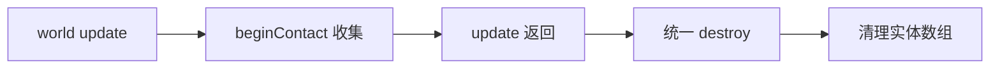

# 碰撞回调

## 四个回调

```lua
self.world:setCallbacks(beginContact, endContact, preSolve, postSolve)
```

| 回调           | 时机                  | 额外参数       |
| -------------- | --------------------- | -------------- |
| `beginContact` | 两个 fixture 开始接触 | 无             |
| `endContact`   | 接触结束              | 无             |
| `preSolve`     | 求解碰撞响应前        | 无             |
| `postSolve`    | 求解碰撞响应后        | 法向与切向冲量 |

每个回调的前三个参数固定是 `fixtureA, fixtureB, contact`。`postSolve` 在 contact 之后还会收到冲量，接触点有几个就传几组。

- `beginContact` 每次接触只触发一次，静止贴合不会每帧重复
- `endContact` 在分开或对象销毁时触发
- `preSolve` 在求解前触发，可用 `contact:setEnabled(false)` 取消响应
- `contact:getNormal()` 给出法线，`getPositions()` 给出接触点

课程只实现 `beginContact`，另外三个留空；所有判定都写在接触开始那一刻。

## 回调里能做什么

- 读两个 fixture 的 `userData`
- 读 body 的速度、位置、角度
- 把要销毁的 body 塞进列表
- 播放音效、加分、标记状态
- 查询 `contact:isTouching()`

不能创建或销毁 body、fixture、joint。Box2D 在回调期间锁定世界，任何结构性修改都会崩。连 `setPosition` 这类修改也不安全，稳妥做法是只读、只排队。

`contact` 对象是临时的，不要存进表里下次再用。需要后续处理时，把 fixture 或 body 存下来。

## 延迟销毁

课程把所有待删 body 收进 `destroyedBodies`，等 `world:update` 全部返回后再统一销毁。

```lua
function beginContact(a, b, contact)
    if a:getUserData() == 'Player' and b:getUserData() == 'Obstacle' then
        local vx, vy = a:getBody():getLinearVelocity()

        if math.abs(vx) + math.abs(vy) > 20 then
            table.insert(self.destroyedBodies, b:getBody())
        end
    end
end

-- world:update 之后
for _, body in ipairs(self.destroyedBodies) do
    if not body:isDestroyed() then
        body:destroy()
    end
end

self.destroyedBodies = {}
```



- `isDestroyed()` 防止同一帧第二次销毁报错；销毁 body 会连带 fixture 与 joint
- 一个 body 挂多个 fixture 时会分别回调，扣血要先去重
- `obstacles`、`aliens` 数组用 `table.remove` 倒序删，正序会跳过元素

## 用 userData 分类

课程给每个 fixture 打一个字符串标签：鸟是 `'Player'`，敌人是 `'Alien'`，障碍是 `'Obstacle'`，地面是 `'Ground'`。

回调收到的两个 fixture 顺序不固定，不能假设 `a` 一定是玩家。常见写法是两边都判断：

```lua
local types = {}
types[a:getUserData()] = true
types[b:getUserData()] = true

if types['Player'] and types['Alien'] then
    local playerFixture = a:getUserData() == 'Player' and a or b
    local alienFixture = a:getUserData() == 'Alien' and a or b
end
```

字符串写错不会报错，只会静默不触发。需要更多数据时可以把整个实体表设为 `userData`，回调里直接拿到 `hp`、`material` 等字段。

## 阈值与伤害

课程用 `math.abs(vx) + math.abs(vy) > 20` 判断冲击是否足够。这是曼哈顿距离，斜向撞击会被高估约四成；更准确的是平方和开根，或者直接用接触冲量。阈值太低，鸟刚落地就拆掉整座堡垒；太高，怎么撞都不碎。课程取 20 像素/秒，配合 300 像素/秒的发射速度，留出了区分度。

`postSolve` 给出的法向冲量包含质量因素，更适合做伤害计算：同样的速度，金属块撞过来的冲量远大于玻璃。用速度阈值则简单、可预测，适合课程这种小规模玩法。
