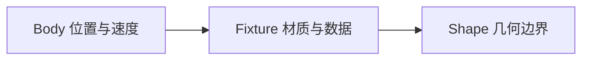

# Shape 与 Fixture

body 只有位置，没有边界。fixture 把 shape 钉到 body 上，同时定义密度、摩擦、弹性和类型标签。

## 三层结构



| 层      | 负责                       | 创建方式                            |
| ------- | -------------------------- | ----------------------------------- |
| Body    | 位置、角度、速度           | `love.physics.newBody`              |
| Fixture | 密度、摩擦、弹性、userData | `love.physics.newFixture`           |
| Shape   | 几何边界                   | `love.physics.newRectangleShape` 等 |

一个 body 可以挂多个 fixture，比如车身加两个轮子。碰撞时每个 fixture 独立参与计算，mass 会累加。

## 形状

| 形状   | 构造                           | 用途           |
| ------ | ------------------------------ | -------------- |
| 矩形   | `newRectangleShape(w, h)`      | 箱子、木板     |
| 圆     | `newCircleShape(r)`            | 鸟、球         |
| 边     | `newEdgeShape(x1, y1, x2, y2)` | 地面、墙       |
| 多边形 | `newPolygonShape(vertices)`    | 三角、自定义块 |

- 矩形的 `w`、`h` 是完整宽高，不是半宽；局部原点在中心
- 圆只接收半径，传直径会得到两倍大的碰撞体
- `EdgeShape` 是没有厚度和面积的线段，适合地面与边框
- `PolygonShape` 要求凸多边形，顶点按顺序给，上限 8 个，超过或凹形要拆

```lua
local shape = love.physics.newPolygonShape(
    0, -17.5,
    17.5, 17.5,
    -17.5, 17.5
)
```

## 材质属性

| 方法                 | 作用                   | 常用值     |
| -------------------- | ---------------------- | ---------- |
| `setDensity(d)`      | 影响质量与惯性         | 默认 1     |
| `setFriction(f)`     | 接触面的滑动阻力       | 地面 `0.5` |
| `setRestitution(r)`  | 弹性，`0` 到 `1`       | 鸟 `0.4`   |
| `setSensor(true)`    | 只触发回调，不产生碰撞 | 触发区     |
| `setUserData(value)` | 存任意 Lua 值          | `'Player'` |
| `getBody()`          | 反查所属 body          | 回调里常用 |

`restitution` 为 `0` 时完全不弹，为 `1` 时理论上不损失能量。0.4 的鸟落地会弹几下，然后被摩擦拖停。

- `sensor` 仍触发 `beginContact` 与 `endContact`，但物体直接穿过
- `userData` 可存字符串、数字或表，课程用字符串区分四种对象
- 回调参数是 fixture，`getBody()` 是最直接的反查入口

## 绘制

最省事的方式是让 Box2D 返回旋转后的顶点：

```lua
love.graphics.polygon('fill', body:getWorldPoints(shape:getPoints()))
```

`body:getWorldPoints` 会把局部坐标按 body 的位置和角度变换到世界坐标，所以方块翻滚时碰撞盒跟着转。

`shape:getPoints()` 返回扁平数组 `x1, y1, x2, y2 ...`，直接交给 `getWorldPoints` 即可，不要自己再拼一层 table。

- 圆形用 `body:getX()`、`body:getY()` 加 `shape:getRadius()` 画
- 精灵用 body 的角度作为旋转，绘制原点设为半宽半高
- 调试时把 `fill` 换成 `line`，叠在精灵上看碰撞盒是否对齐
- 碰撞盒通常比贴图略小，视觉更自然

## 复合物体

一个 body 挂多个 fixture 就能拼出非矩形物体，例如车身加两个圆轮：

```lua
local chassis = love.physics.newFixture(body, love.physics.newRectangleShape(60, 20), 2)
local wheelA = love.physics.newFixture(body, love.physics.newCircleShape(10), 1)
```

这些 fixture 共享同一个 body 的位置和旋转，但不会相对转动。真正的车轮需要独立的 body 加关节，见「关节」一页。

同一个 shape 也可以传给多个 fixture；Box2D 会把顶点数据复制到各自的 body，之后互不影响。

## 常见坑

- 只创建 body 不创建 fixture，物体穿过一切
- 把矩形宽高当成半宽半高，碰撞盒大一倍
- 用 circle 的直径当半径
- 碰撞盒远大于贴图，看起来像隔空碰撞
- 忘记给地面 fixture 设 `userData`，回调里认不出
- 以为 sensor 会挡住物体，结果直接穿过
- 密度设得极端，碰撞表现失真
