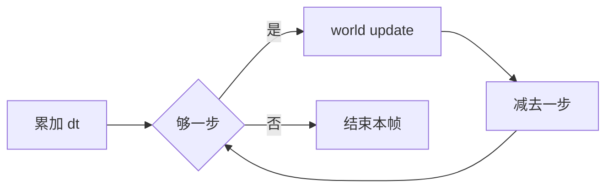

# 物理世界

## 世界是容器

`world` 不是场景，也不负责绘制。它持有 body、joint 和接触信息，`world:update(dt)` 时执行碰撞检测、求解约束、更新位置。

```lua
world = love.physics.newWorld(0, 300)
```

前两个参数是 X、Y 方向的重力。第三个参数 `sleep` 默认 `true`，静止的物体会休眠，减少无效计算。

俯视游戏把两个重力都设成 0，物体只受冲量、关节和阻尼影响；水下关卡可以把 Y 调到 50 左右，下落变慢，浮力感更强。

| 调用                                   | 作用           |
| -------------------------------------- | -------------- |
| `love.physics.newWorld(gx, gy, sleep)` | 创建世界       |
| `world:update(dt, velIter, posIter)`   | 推进模拟       |
| `world:getGravity()`                   | 读回重力       |
| `world:getBodyCount()`                 | 当前 body 数量 |
| `world:setCallbacks(...)`              | 注册碰撞回调   |

LÖVE 11 里 `velocityIterations` 默认 8，`positionIterations` 默认 3。调高更稳定，代价是每帧更慢。

## 单位与坐标

Box2D 内部以米计算，LÖVE 在 API 边界按比例换算，默认 30 像素等于 1 米。地球重力 9.8 m/s² 因此写成 `9.8 × 30 ≈ 300` 像素每二次方秒。

`love.physics.setMeter(30)` 可以改比例，但要在创建任何物理对象之前调用。已有对象的米制坐标不会重算，换算结果会突然改变。

| 量   | 单位     | 例子                           |
| ---- | -------- | ------------------------------ |
| 位置 | 像素     | `newBody(world, 320, 180)`     |
| 速度 | 像素/秒  | `setLinearVelocity(300, -200)` |
| 重力 | 像素/秒² | `newWorld(0, 300)`             |
| 角度 | 弧度     | `body:getAngle()`              |
| 质量 | 千克     | `body:getMass()`               |

Box2D 建议动态形状落在 0.1 到 10 米之间，按 30 像素/米算就是 3 到 300 像素。35 像素的方块约 1.2 米，正合适；静态地面通常用一条很长的 `EdgeShape`，不必拼成小段。

## 固定步长

直接 `world:update(dt)`，低帧率时会给出很大的 `dt`，物体一步跨过障碍，看起来像穿墙。课程用累加器把物理固定在 60 Hz：

```lua
local FIXED_DT = 1 / 60
local accumulator = 0

function Level:update(dt)
    accumulator = math.min(accumulator + dt, 0.25)

    while accumulator >= FIXED_DT do
        self.world:update(FIXED_DT)
        accumulator = accumulator - FIXED_DT
    end
end
```

`math.min` 是保险：一帧卡了 2 秒时最多补 0.25 秒，避免一次算上百步、把帧率拖得更低。



高速物体还可以给 body 打开 `setBullet(true)`，让 Box2D 做连续碰撞检测。静态 body 本来就总是用连续检测，所以墙不会被高速物体穿过。

物理频率不必等于渲染频率。60 Hz 是 Box2D 的经验值，30 Hz 更省 CPU，但快速物体更容易漏判；再低就会看到堆叠物抖动和穿透。

## 生命周期

一个关卡一个 world，换关就重建。body 创建时绑定 world，之后不能搬到另一个世界。销毁用 `body:destroy()`，挂在上面的 fixture 与 joint 一起失效。

不要在 `beginContact` 里改世界。Box2D 在回调期间锁定世界，增加或删除对象会崩溃。把要删的 body 收集起来，等 `world:update` 返回后再处理。
