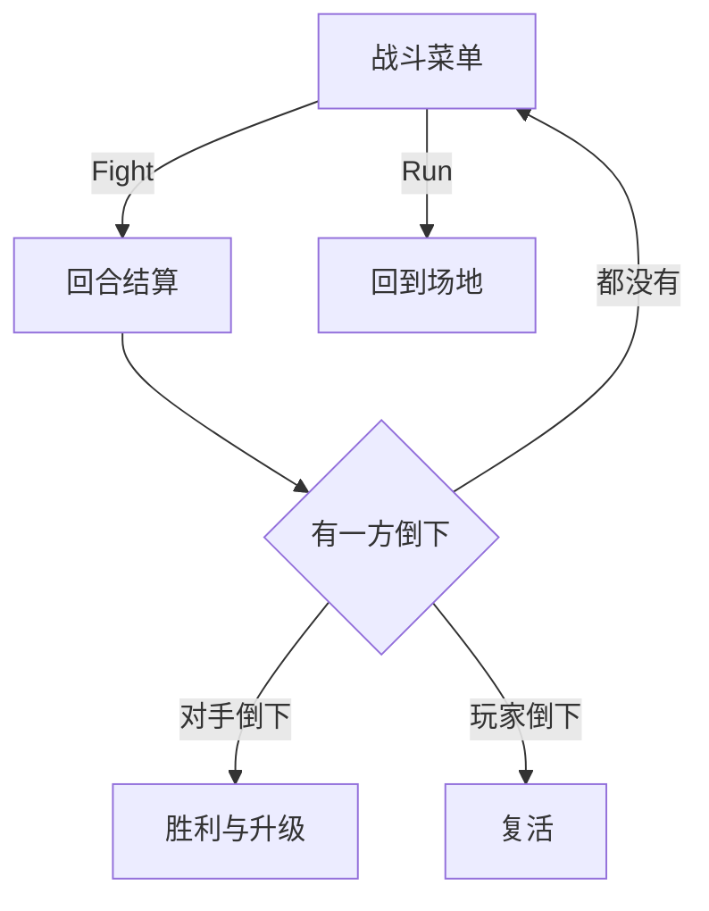

# 回合制战斗

战斗没有物理引擎，只有一张行动表：谁先动、打掉多少、谁先归零。

## 战斗状态持有的一切

`BattleState` 构造时准备三样东西：双方的 `party`、一条底部面板、两条血条。

```lua
self.opponent = Opponent {
    party = Party {
        pokemon = { Pokemon(Pokemon.getRandomDef(), math.random(2, 6)) }
    }
}

self.playerHealthBar = ProgressBar {
    x = VIRTUAL_WIDTH - 160, y = VIRTUAL_HEIGHT - 80,
    width = 152, height = 6,
    color = {r = 189/255, g = 32/255, b = 32/255},
    value = self.player.party.pokemon[1].currentHP,
    max = self.player.party.pokemon[1].HP
}
```

血条的 `value` 指向当前血量，`max` 指向上限。上限全程不变，所以进度条会随伤害缩短，而不是整条一起动。

战斗状态本身不处理按键。它只负责搭场景、画贴图、放着两个进度条，然后把流程交给子状态。

| 状态                 | 职责               | 停留时间   |
| -------------------- | ------------------ | ---------- |
| `BattleState`        | 场景、贴图、血条   | 整个战斗   |
| `BattleMessageState` | 显示一句话，等回车 | 一句话     |
| `BattleMenuState`    | 给出 Fight 与 Run  | 等玩家选择 |
| `TakeTurnState`      | 算出并演出一次攻击 | 一个回合   |

拆成四个状态而不是一个巨型 `update`，是因为每个阶段等待的东西不同：等回车、等选择、等动画。状态本身只表达「我在等什么」，流程就变成压栈与弹栈。

## 台词与菜单

进入战斗先播两句话：「野生的 X 出现了」和「去吧 X」。用嵌套回调串起来：

```lua
gStateStack:push(BattleMessageState('A wild ' .. name .. ' appeared!', function()
    gStateStack:push(BattleMessageState('Go, ' .. name .. '!', function()
        gStateStack:push(BattleMenuState(self))
    end))
end))
```

每句台词都是一个压栈的状态，关闭时弹出自己并调用回调，回调再压下一层。三层嵌套的括号看着难受，但执行顺序一目了然：这行代码跑完，栈顶就是菜单。

- `BattleMessageState` 的第三个参数控制是否接受输入，攻击台词传 `false`，回车被忽略
- 用一个参数而不是两个类，省下的是重复文件
- `BattleMenuState` 里放一个 `Menu`，选项固定为 Fight 与 Run
- Run 退出战斗回到场地，Fight 压入 `TakeTurnState`

## 回合结算

先比速度。快的一方先手，代码不写两套流程，只交换指针：

```lua
if player.speed > opponent.speed then
    self.firstPokemon, self.secondPokemon = player, opponent
    self.firstSprite, self.secondSprite = playerSprite, opponentSprite
else
    self.firstPokemon, self.secondPokemon = opponent, player
    ...
end
```

后面只调用 `attack(first, second)`，不用关心谁是谁。速度相同时默认对手先手，这是 `else` 分支的副作用，不是什么设计。



单次攻击分三段演出，全部用 `Timer` 串起来：攻击方的可见性切换六次，防守方的透明度切换六次，血条在 0.5 秒内缩到新值。

```lua
local dmg = math.max(1, attacker.attack - defender.defense)

Timer.tween(0.5, {
    [defenderBar] = { value = defender.currentHP - dmg }
}):finish(function()
    defender.currentHP = defender.currentHP - dmg
    onEnd()
end)
```

`math.max(1, ...)` 保证至少掉 1 点，否则防御高于攻击时战斗永远打不完。伤害在 tween 结束时才写回，动画期间的 `currentHP` 还是旧值，这样连续两次攻击不会叠加出错。

| 数值    | 取值时机         | 说明                             |
| ------- | ---------------- | -------------------------------- |
| `value` | 每次受击         | 先 tween，结束后同步 `currentHP` |
| `max`   | 创建时           | 等于 `HP`，不变                  |
| 先手    | 每次进入回合状态 | 比较 `speed`                     |
| 伤害    | 每次攻击         | `attack - defense`，下限 1       |

`Timer.every(0.1, fn):limit(6)` 是闪烁的实现：每 0.1 秒切一次可见性，六次之后停下。`limit` 是 hump Timer 的链式方法，忘了它就会一直闪到战斗结束。

## 倒下与复活

`checkDeaths` 只做一件事：看两边的 `currentHP` 是否小于等于 0。

```lua
if self.playerPokemon.currentHP <= 0 then
    self:faint()
elseif self.opponentPokemon.currentHP <= 0 then
    self:victory()
end
```

顺序有讲究：先判玩家。双方同一回合都归零时，玩家优先进入复活流程，不会出现「明明倒下了却在结算经验」的画面。

玩家倒下不是游戏结束，而是弹一句提示并恢复。教学项目这样做省掉了「读档重来」的完整流程，但也意味着战斗没有失败状态，玩家只会赢或者跑。

## 经验与升级

对手倒下后给经验，公式是四项 IV 之和乘对手等级：

```lua
local exp = (opp.HPIV + opp.attackIV + opp.defenseIV + opp.speedIV) * opp.level
```

IV 越高、等级越高，给的经验越多。经验累积到 `expToLevel` 就升级，`expToLevel = level * level * 5 * 0.75`，每级需要量按平方增长。

`levelUp` 做三件事：

- 等级加一
- 重算 `expToLevel`
- 调用 `statsLevelUp` 掷骰加属性

这套数值有两个明显问题：伤害公式没有属性克制、没有命中判定、没有暴击，一场战斗的随机性只剩速度与升级；经验只与对手有关，与打得多辛苦无关。把公式抽成独立函数，替换成更完整的计算时，`TakeTurnState` 一行都不用改。

经验条可以复用同一个 `ProgressBar`：`value = currentExp`，`max = expToLevel`。升级后 `max` 变了，条自动缩短，正好对应「下一级更难」的体感。记得在升级时把 `currentExp` 清零或减去阈值，否则经验条会一直顶格。
