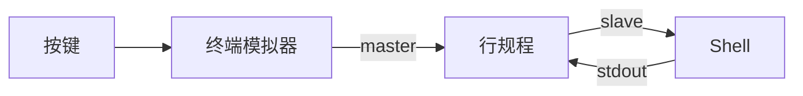

# 打开终端后发生了什么

Shell 不直接连着键盘和屏幕，中间隔着伪终端和行规程。

## 数据通路



- 模拟器申请一对 pty：master 和 slave
- Shell 的 fd 0/1/2 接在 slave 上
- 模拟器从 master 读字节，画到窗口

| 检查方式 | 命令                |
| -------- | ------------------- |
| Linux fd | `ls -l /proc/$$/fd` |
| macOS fd | `lsof -p $$`        |
| 终端设备 | `tty`               |

## 行规程

| 按键     | 行为                    |
| -------- | ----------------------- |
| `Ctrl-C` | 前台进程组收到 `SIGINT` |
| `Ctrl-\` | `SIGQUIT`               |
| `Ctrl-Z` | `SIGTSTP`，挂起         |
| `Ctrl-D` | 缓冲区为空时表示 EOF    |
| 回车     | 把整行交给 Shell        |

关键概念是前台进程组：终端驱动不认识“当前程序”，只把信号发给前台组，组里所有进程一起收到。

```bash
stty -a     # 查看模式
stty raw    # 原始模式
stty sane   # 恢复正常
```

## raw 模式与全屏程序

- `vim`、`less`、`tmux` 自己关闭回显和行编辑
- 按键直接由程序处理，光标靠转义序列重绘
- 退出时恢复终端；恢复失败用 `reset`
- `script -q session.log` 可以录下整次会话

## 关闭终端

| 手段          | 效果                              |
| ------------- | --------------------------------- |
| 直接关窗口    | 会话收到 `SIGHUP`，后台任务退出   |
| `nohup cmd &` | 忽略 `SIGHUP`，输出进 `nohup.out` |
| `disown`      | 从作业表移除，不再收挂断          |
| `setsid`      | 新会话，脱离控制终端              |
| `tmux`        | 会话独立存在，可重新接上          |

`ssh host cmd` 默认不分配 tty，所以远端程序会关掉颜色和交互；需要时用 `ssh -t`。
