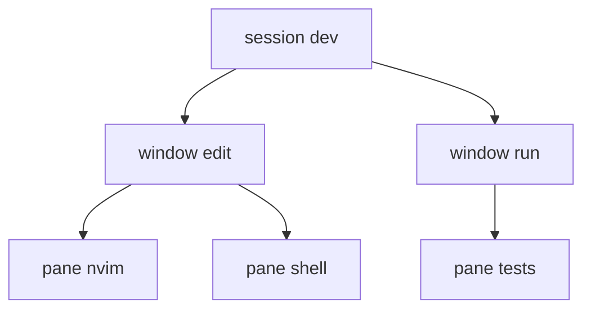

# 终端复用

tmux 把一个终端窗口变成可以拆分、随时离开、随地接回的会话。

## 三层结构

session 是工作区，window 是标签页，pane 是分割出来的矩形。关掉终端只是断开客户端，session 里的进程继续跑。



| 操作     | 命令                           |
| -------- | ------------------------------ |
| 新建会话 | `tmux new -s dev`              |
| 列出会话 | `tmux ls`                      |
| 接入会话 | `tmux a -t dev`                |
| 分离     | `<C-b> d`                      |
| 新建窗口 | `<C-b> c`                      |
| 切换窗口 | `<C-b> 0`…`<C-b> 9`、`<C-b> n` |
| 左右分屏 | `<C-b> %`                      |
| 上下分屏 | `<C-b> "`                      |
| 放大窗格 | `<C-b> z`                      |
| 复制模式 | `<C-b> [`，`q` 退出            |
| 关闭窗格 | `<C-b> x`                      |

`<C-b>` 是前缀键，不是组合键：先按 `Ctrl-b` 松开，再按后面的键。前缀之后所有按键都交给 tmux，不传给里面的程序。

## 一条命令开好工作区

`new -A` 是「有就接入，没有就新建」，写进 shell 启动脚本后，每次 `ssh` 上去都回到同一个现场。

```bash
tmux new -A -s dev -c ~/proj          # 建会话并指定起始目录
tmux send-keys -t dev:1 'pytest -q' C-m   # 往指定窗口送一条命令
tmux split-window -h -t dev:1         # 脚本里直接分屏
```

`send-keys` 的 `C-m` 代表回车。这个能力让 tmux 可以当轻量调度器：一条命令拉起「编辑、测试、日志」三个窗格，顺序固定，不用每天手点。

在 tmux 里按 `<C-b> :` 输入 `setw synchronize-panes on`，可以把键盘输入同步到当前窗口所有窗格，适合一次在五台机器上敲同一条命令。用完记得关掉。

## 断线与长任务

`nohup` 只是让进程忽略 `SIGHUP`，输出还留在文件里；tmux 让进程保持在一个可交互的终端上。两者的区别不是「哪个更持久」，而是「之后还要不要说话」。

| 手段          | 交互 | 重连 | 多窗格 | 输出             |
| ------------- | ---- | ---- | ------ | ---------------- |
| `nohup cmd &` | 无   | 无   | 无     | 重定向到文件     |
| `disown`      | 无   | 无   | 无     | 仍写原终端       |
| `tmux`        | 有   | 有   | 有     | 留在 pane 里可翻 |
| `systemd-run` | 无   | 无   | 无     | `journalctl`     |

跑训练任务、长时间编译、需要中途输入密码的命令，选 tmux。真正无人值守的守护进程应该交给 systemd 或容器编排，而不是 tmux。

## 配置与嵌套

`~/.tmux.conf` 里最常改的两项是前缀和鼠标：

```bash
set -g mouse on
set -g base-index 1
setw -g pane-base-index 1
set -g prefix C-a
bind C-a send-prefix
```

`bind C-a send-prefix` 是嵌套用的：本地 tmux 套远端 tmux 时，连按两次前缀把按键递给内层。改完配置用 `tmux source-file ~/.tmux.conf` 生效，或在 `<C-b> :` 里执行同一条命令。

`~/.tmux.conf` 只在 server 启动时读一次，老 server 不会自己重读。`kill-server` 会连同所有 session 一起结束，机器上还跑着任务时别随手用。
