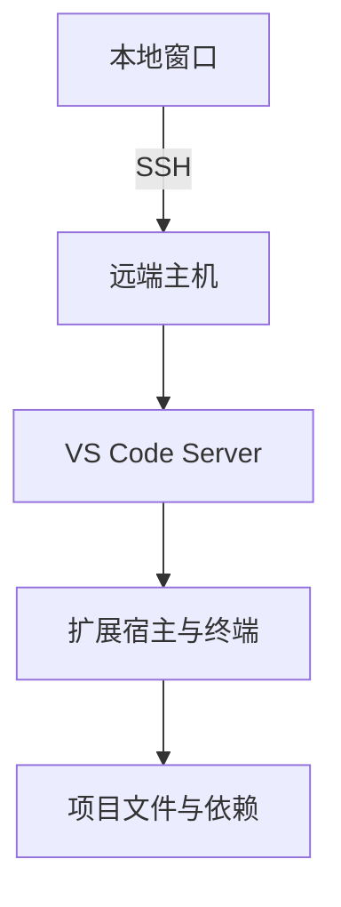

# 远端开发

远端开发把「编辑」和「运行」拆到两台机器上，搞清哪一半在哪跑，能省掉大半排错时间。

## 编辑器拆成两端

VS Code 的 Remote-SSH 不是把文件同步到本地，而是在远端跑一个 headless 服务，本地窗口只负责画面和键盘。扩展分成两类：界面类留在本地，语言服务和调试器装在远端。



服务端组件落在 `~/.vscode-server`，第一次连接时自动下载。远端必须能跑 shell，并且能访问外网拉这个包；隔离内网里通常要手动上传。

端口转发由客户端自动接管：程序监听远端 `8000`，本地打开 `localhost:8000` 就能访问。这些流量裹在 SSH 连接里，从外面看只是一条普通的长连接。

## 容器里的环境

dev container 把工具链固定进镜像，换机器只换一个 `devcontainer.json`，宿主机也因此保持干净。VS Code 的 Dev Containers 扩展会构建镜像、把项目挂进去、在容器里启动同一套远端服务。

```json
{
  "image": "mcr.microsoft.com/devcontainers/python:3.12",
  "postCreateCommand": "pip install -r requirements.txt",
  "forwardPorts": [8000],
  "customizations": {
    "vscode": { "extensions": ["ms-python.python"] }
  }
}
```

`postCreateCommand` 在容器建好后执行一次，适合装依赖；每次启动都要跑的东西放 `postStartCommand`。容器里默认用户可能不是 root，装系统包要加 `sudo` 或写进 Dockerfile。

代价是 Docker 必须在某处运行。本地笔记本跑 Docker 耗电，CI 和大项目更适合把容器跑在远端主机上。

## 纯终端方案

没有图形界面时，`ssh` 加 `tmux` 就是完整答案：连接断了 reattach，编辑器、测试、日志都还在。

- `mosh host`：基于 UDP，切网、休眠、高延迟下比 `ssh` 稳，代价是不支持端口转发
- `rsync -av --exclude .venv src/ host:~/src/`：单向同步，注意源路径末尾的 `/`
- `sshfs host:~/proj ~/mnt`：把远端目录挂到本地，适合临时看文件，不适合在编辑器里索引大项目
- `scp`：一次性拷贝，没有断点续传

远端编译比自己搭一套交叉工具链简单得多，尤其目标机器是 `x86_64` 而你在 `arm64` 笔记本上时。

## 常见的坑

| 现象               | 原因与处理                                 |
| ------------------ | ------------------------------------------ |
| 扩展在远端装不上   | 远端无法访问扩展市场，改用离线安装         |
| 文件改动不触发重载 | `fs.inotify.max_user_watches` 太小，调大   |
| 本地能跑远端报错   | 架构或系统库不同，二进制要为目标平台重编   |
| 提交时提示没有权限 | 私钥留在本地，用 `ForwardAgent` 或远端另配 |
| `~` 被写满         | `~/.vscode-server` 存了多份旧版本，可清理  |

最后一条最容易被忽略：每换一次 VS Code 版本，服务端可能留一份新目录，磁盘小的机器上几个月就能攒出几个 GB。

合作编辑是另一条路：Live Share 让协作者直接进入你的会话，共享光标、终端和调试会话，而不是传文件。它解决的是实时协作，不是环境一致性。
