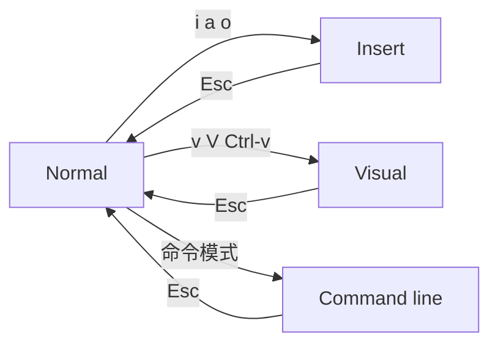

# Vim 的模式与移动

Vim 把「输入文字」和「操作文字」拆成两套键盘，移动命令就是这套语言里的名词。

## 模式决定按键含义

一个 `x` 在 Insert 模式输入字符，在 Normal 模式删掉光标下的字符，在 Visual 模式删掉选区。同一个键三种含义，这就是模态编辑的全部秘密。

| 模式         | 进入方式 | 用途                     |
| ------------ | -------- | ------------------------ |
| Normal       | `<ESC>`  | 移动与执行编辑命令，默认 |
| Insert       | `i`      | 打字                     |
| Replace      | `R`      | 覆盖输入                 |
| Visual       | `v`      | 按字符选中               |
| Visual Line  | `V`      | 按行选中                 |
| Visual Block | `<C-v>`  | 按矩形块选中             |
| Command-line | `:`      | `:w`、`:q`、替换等       |

从 Normal 进入 Insert 有一族入口：`a` 在光标后插入，`I` 在行首，`A` 在行尾，`o` 在下方开新行，`O` 在上方开新行。

左下角会显示当前模式，迷路时先看它。Vim 刻意不用鼠标，也劝你别用方向键：前者让你离开主键区去找指针，后者要移动整只右手，都比 `hjkl` 慢。



## 移动是名词

Vim 的移动命令描述文本块，编辑命令再作用其上。先形成「这里的一个词」「到行尾」这样的空间直觉，按键才记得住。键位大多按助记命名：`w` 是 word，`b` 是 back，`d` 是 delete，`c` 是 change，`y` 是 yank。

| 目标     | 按键                  |
| -------- | --------------------- |
| 字符     | `h` `j` `k` `l`       |
| 词       | `w` `b` `e`           |
| 行首行尾 | `0` `^` `$`           |
| 屏幕三处 | `H` `M` `L`           |
| 半屏     | `<C-u>` `<C-d>`       |
| 文件首尾 | `gg` `G`              |
| 指定行   | `{n}G` 或 `:{n}<CR>`  |
| 配对符号 | `%`                   |
| 行内查找 | `f` `t` `F` `T`       |
| 搜索     | `/{regex}` `?{regex}` |

`{n}G` 与 `:{n}<CR>` 效果相同，前者不离开 Normal，后者会短暂进命令行。改完代码想回到原来的位置，`<C-o>` 可以跳回上一个位置。

## 行内查找与搜索

`f` 找下一个字符，`t` 停在它前面；小写向前，大写向后。这两个命令比连续按 `l` 快得多，尤其在一行里追括号和引号的时候。

```vim
f(        " 跳到本行下一个左括号
3f,       " 跳到本行第三个逗号
;         " 重复上一次 f 或 t
,         " 反向重复
/def main " 向下搜索，回车确认
n         " 下一个匹配
N         " 上一个匹配
```

搜索会记进历史，`/` 之后按方向键上就能重用。`:noh` 清掉高亮，光标停在原地。

## 让 Escape 变便宜

Vim 里按 `<ESC>` 的频率高到会拖慢手指。把 Caps Lock 映射成 Escape 是最划算的一次投资，macOS 在「系统设置 → 键盘 → 键盘快捷键 → 修饰键」里就能改。

不想动系统键位，也可以在插入模式里映射 `jk`：

```vim
inoremap jk <ESC>
```

`inoremap` 只作用于 Insert 模式，不会污染 Normal 模式里的 `j`、`k`。映射之后打字稍慢一点，但手不用离开主键区。

## 练习路径

`vimtutor` 是 Vim 自带的交互教程，半小时能过一遍基础。之后最好的练习方式是把编辑器、Shell、浏览器的 Vim 模式全打开，逼自己在真实任务里用。

- `vimtutor`：自带教程，讲模式、移动、删除、粘贴
- `set -o vi`：bash 的行编辑进入 vi 模式，`<ESC>` 后可用移动命令
- `bindkey -v`：zsh 的同类开关
- VimGolf：用最少按键完成一次编辑，专练组合

头一周效率一定下降，这是正常的。判断标准不是「比原来快」，而是「还需要几次查文档」。
