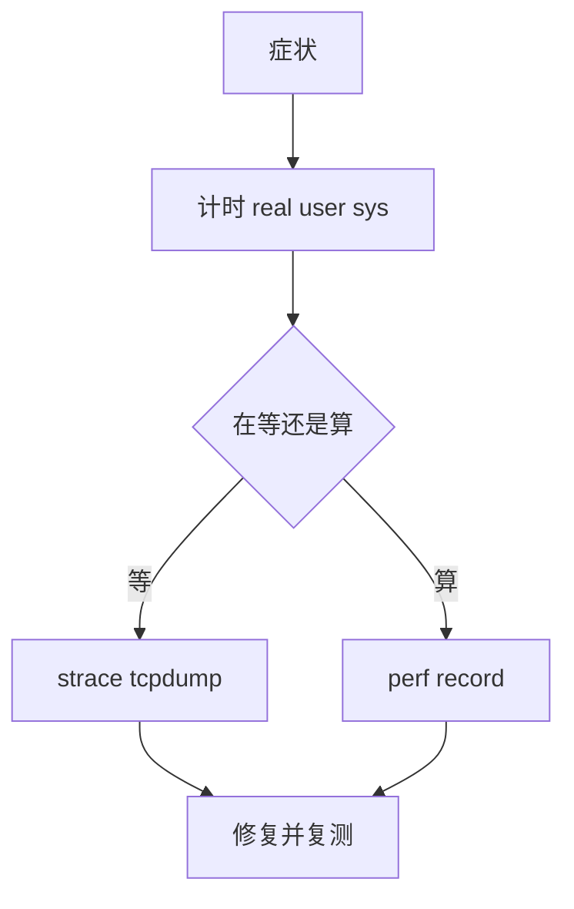

# 容易混淆的问题

工具的名字很接近，解决的问题却不同。下面按「想回答什么问题」来区分，而不是按命令记。

## 打印、断点与录制

| 手段           | 回答的问题               | 代价                    |
| -------------- | ------------------------ | ----------------------- |
| `print` / 日志 | 程序运行到某处时值是多少 | 改代码，可能改变时序    |
| 断点           | 执行到某行时的完整状态   | 需要符号，程序会停      |
| `watch`        | 这个变量是谁改的         | 监视地址，作用域外失效  |
| `rr`           | 上一次失败到底怎么发生的 | 需要 Linux 和性能计数器 |

`print` 与调试器的分界不是「简单与高级」，而是「知不知道要看什么」。知道要打印什么，`print` 更快；不知道，调试器能一次给出变量、栈和内存。

rr 不替代调试器，它只是把「一次执行」变成可重复的实验材料。真正的检查仍然靠 gdb 的命令。

- 条件断点在执行到某行时判断表达式
- `watch` 在值变化时停下，不管代码走到哪一行
- 日志写 stderr，stdout 留给管道数据
- 断点没停，先确认二进制和源码版本一致
- rr 序列化线程调度，依赖时序的竞态可能录不出来

## 追踪与剖析

| 工具        | 观察对象         | 典型问题                        |
| ----------- | ---------------- | ------------------------------- |
| `strace`    | 系统调用         | 卡在哪个 `read`、哪个文件打不开 |
| `bpftrace`  | 内核事件与聚合   | 全系统谁在打开文件、延迟分布    |
| `perf`      | CPU 采样         | 时间花在哪些函数                |
| `callgrind` | 每次调用的指令数 | 精确调用次数与调用关系          |

`strace` 看到的是「程序向内核要了什么」，`perf` 看到的是「CPU 在用户态执行什么」。程序卡在网络上时，`perf` 火焰图里可能什么都没有。

采样与追踪也不是一回事。采样按固定频率抓栈，开销低但会漏掉短函数；追踪记录每次进入退出，精确但慢几十倍。

- `-T` 的耗时是墙钟时间，不是 CPU 时间
- 和 `perf` 对不上时，通常是在等锁、等 I/O 或等调度

## 内存工具

| 工具              | 查什么                     | 是否重编译 |
| ----------------- | -------------------------- | ---------- |
| ASan              | 越界、use-after-free、泄漏 | 是         |
| Valgrind memcheck | 非法访问、未初始化值、泄漏 | 否         |
| Massif            | 堆使用随时间的曲线         | 否         |
| `memory-profiler` | Python 每行内存增量        | 否         |

ASan 报的是「这次访问非法」，Massif 画的是「堆用了多少」。前者是错误，后者是用量，峰值高不等于有 bug。

`definitely lost` 才是确定泄漏，`still reachable` 多半是全局缓存。Massif 曲线不回落也可能只是连接池没释放，判断前先看分配栈。

- TSan 只报数据竞争，UBSan 只报未定义行为
- 两者都不能替代 ASan 的越界检查

## 数字怎么读

- `real` 是墙钟，`user + sys` 是 CPU 时间
- `real` 远大于 CPU 时间，说明在等 I/O 或锁
- 多线程下 `user + sys` 可以超过 `real`
- 平均值会掩盖长尾，P99 更接近用户感受
- 火焰图宽度是样本占比，不是耗时绝对值
- 火焰图左右顺序没有时间含义

基准的差异要超过噪声才算数。先看标准差和最小值，再看均值；两个分布重叠严重时，倍数没有意义。

## 一条排查链

```bash
time ./prog                      # 先分清 CPU 还是等待
strace -f -T -o trace.log ./prog # 卡住时看最后一个系统调用
perf record -g ./prog            # 有 CPU 热点再剖析
perf report
gcc -fsanitize=address -g prog.c -o prog && ./prog
```



顺序不是教条。崩溃类问题直接上 ASan，偶发崩溃直接上 rr，反而更快。

不管走哪条路，最后都要回到同一个复现用例，确认修复前后行为确实变了。

## 常见误区

- 把 `strace` 当成性能剖析工具，它主要回答「做了什么」
- 用 `perf` 分析阻塞在网络上的程序，火焰图几乎是空的
- 看到 Massif 峰值就认定泄漏
- 用一次 `time` 的结果比较两个实现
- 认为火焰图越宽的函数一定越值得优化
- 把 rr 录制的失败当成「问题已经修好」
- 把条件断点和 `watch` 当成同一件事
- 用 `perf` 的采样比例反推函数调用次数
- 认为 `strace` 能显示程序内部函数调用
- 把 Valgrind 的慢当成程序本身的性能
- 以为 `perf` 能指出具体哪一行慢，它只给样本分布
- 把采样频率当成精度上限，函数比采样间隔短就会被漏掉
