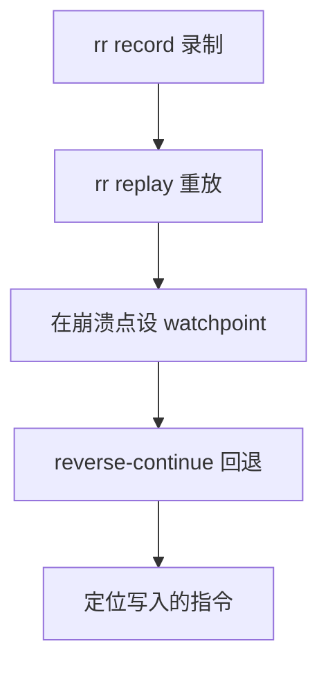

# 记录回放调试

最难受的 bug 不是不会修，而是修的时候它不出现。记录回放把一次执行完整存下来，之后可以反复重放，还能倒着走。

## Heisenbug

这类 bug 在观察时改变行为：

- 加了 `printf` 之后不再复现
- 只在机器负载高时出现
- 只在特定线程交错顺序下触发
- 单步调试时正常，直接运行就崩

原因是观测手段本身改变了时序。`printf` 要加锁、要写文件，几微秒的延迟足以让竞态消失。重跑一次又是新的调度，问题可能再也不出现。

日志级别也会影响结果：把 `DEBUG` 打开后程序变慢，超时不再触发。看起来像「修好了」，其实只是把窗口错过了。

## rr 的工作方式

rr 录制一次执行，保存所有非确定性输入：系统调用结果、信号、线程调度。重放时按记录喂回这些输入，程序走同一条路径。

```bash
rr record ./corruption
rr replay
```

重放直接进入 GDB。因为执行是确定的，你可以反复停在同一个位置，也可以反向执行。

| 命令               | 简写 | 作用                     |
| ------------------ | ---- | ------------------------ |
| `reverse-continue` | `rc` | 反向运行到上一个断点     |
| `reverse-step`     | `rs` | 反向单步，进入函数       |
| `reverse-next`     | `rn` | 反向单步，不进入         |
| `reverse-finish`   |      | 反向跑到当前函数的调用点 |

- 录制文件放在 `~/.local/share/rr/`，体积随执行时长增长
- `rr replay -a` 从头重放到结束，用来确认失败是否稳定

## 抓内存被谁改写

一个典型流程：程序在 A 处正常，在 B 处发现数据被改坏，中间隔着几万行代码。

```text
(gdb) watch students[1].id
(gdb) continue
# 命中，值已经被改
(gdb) reverse-continue
# 停在真正写入的那一行
```

正向调试只能在你猜的位置下断点；反向调试从「已经坏了」倒推「什么时候坏的」，搜索空间小得多。反向执行不是把程序「倒着算」，而是回到上一个被记录的状态再重放。所以它依赖录制完整，跳过的系统调用会让状态对不上。



## 限制

rr 不是万能的：

- 只支持 Linux，依赖硬件性能计数器
- 多数云主机不暴露计数器，录制直接失败
- 不支持 GPU
- 录制时线程被序列化，依赖特定时序的竞态可能录不出来
- 录制有开销，不适合长时间运行的服务
- 容器里跑 rr 需要额外权限，通常要放宽 `ptrace` 限制
- 同一份录制可以反复重放，结果一致

遇到录不出的竞态，可以多录几次，或者先把用例缩小到能稳定失败。

macOS 上没有 rr，讲义提到 Warpspeed 作为替代方向。容器里跑 rr 需要额外权限，通常要 `--privileged` 或放宽 `ptrace` 限制。

## 和其他工具的分工

| 问题                     | 工具     |
| ------------------------ | -------- |
| 偶发崩溃，想要确定性重放 | `rr`     |
| 想知道调用了哪些系统调用 | `strace` |
| 想知道哪段代码慢         | `perf`   |
| 想知道内存越界在哪       | ASan     |

rr 的价值在「时间旅行」，不在替代其他工具。

它也不负责解释业务逻辑。录制只能告诉你「执行了什么」，至于「为什么这样写」，仍然要读代码和测试。

## 常见坑

- 换机器或升级依赖后重放，录制对不上原始二进制
- 把 rr 的录制文件当成可移植的调试产物
- 只在 rr 下测试，忽略了真实调度下的表现
- 在 rr 里设 `watch` 后忘了它监视内存地址，栈变量复用会误触发
- 把 `rc` 当成撤销，它只回退执行，不恢复文件或外部状态
- 录制时程序依赖的文件在重放前被删掉，行为立刻偏离
- 程序依赖外部服务或共享内存，重放时状态已经变了
