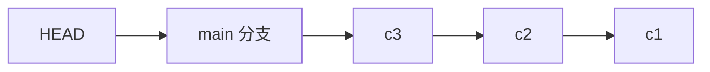

# 分支与 HEAD

分支只是指向某个提交的引用，切换分支就是移动 `HEAD` 并替换工作区文件，代价几乎为零。

## 分支是引用

`git branch` 创建分支时只写一个 41 字节的文件，里面是提交哈希。所以建分支不复制任何文件，删除分支也不影响提交本身。

```bash
git branch feature        # 只创建
git switch feature        # 切换
git switch -c hotfix      # 创建并切换
git switch -              # 回到上一个分支
git branch -a             # 含远端跟踪分支
```

`git switch` 与 `git checkout` 在切换分支上等价，前者是 2.23 之后拆出来的专用命令，语义更清楚。

## HEAD 是什么

`HEAD` 通常存一行 `ref: refs/heads/main`，表示「我在 main 上」。在这种状态下提交，Git 会先更新 main 指向新提交，再让 `HEAD` 继续指向 main。



引用关系是链式的：`HEAD` 指分支，分支指提交，提交指父提交。`git rev-parse HEAD` 和 `cat .git/HEAD` 分别看到链条的两端。

| 状态      | `HEAD` 内容            | 提交后         |
| --------- | ---------------------- | -------------- |
| 在分支上  | `ref: refs/heads/main` | 分支前移       |
| 分离 HEAD | 直接是提交哈希         | 新提交无人引用 |

## 分离 HEAD

`git switch --detach <rev>` 或 `git checkout <rev>` 会直接指向某个提交，此时不在任何分支上。适合临时查看旧版本、跑一次构建，不适合长期开发。

在分离状态下的新提交只被 `HEAD` 引用，切走之后就只能靠哈希或 `git reflog` 找到。补救办法是先建分支再切过去：`git switch -c rescue`。

## 删除与重命名

```bash
git branch -d feature     # 未合并会拒绝
git branch -D feature     # 强制删除
git branch -m old new     # 重命名
git branch -vv            # 看每个分支的 upstream 与领先落后
```

`-d` 的拒绝是保护：分支上还有没合并的提交，删掉引用后提交会变成孤儿。真删错了，用 `git reflog` 找到旧哈希，再 `git branch feature <sha>` 恢复。

`main` 与 `master` 没有技术差别，只是默认分支名的约定。`git init -b main` 可以在建库时直接指定。

## 延伸：tag 与分支的区别

tag 也指向提交，但默认约定为不动。`git tag v1.0` 是轻量标签，`git tag -a v1.0 -m "release"` 会创建一个带作者和说明的独立对象。发布版本用 tag，日常开发用分支。

分支可以随提交自动前移，tag 不会。删掉分支不会删提交，删掉 tag 也不会。
