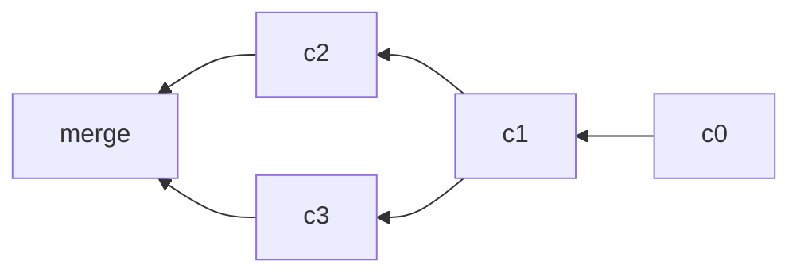

# 数据模型

Git 的命令难记，底下的模型却很小：仓库就是一堆对象加一组引用，每条命令都在改这两样东西。

## 三种对象

| 对象     | 对应 | 存什么                           |
| -------- | ---- | -------------------------------- |
| `blob`   | 文件 | 纯字节，不含文件名               |
| `tree`   | 目录 | 名字到 `blob` 或 `tree` 的映射   |
| `commit` | 快照 | 顶层 `tree`、parents、作者、消息 |

`blob` 不带文件名，所以重命名文件不会产生新的 `blob`，同一份内容在库里只存一次。名字由 `tree` 负责，它把 `bar.txt` 这样的字符串指向某个哈希。

```
<root> (tree)
├── foo (tree)
│   └── bar.txt (blob "hello world")
└── baz.txt (blob "git is wonderful")
```

对象内部存的是子对象的哈希，不是内容副本。用 `git cat-file -p` 逐层展开就能看到这层指针关系。

```bash
git cat-file -t HEAD          # commit
git cat-file -p HEAD          # tree、parent、author、message
git cat-file -p 'HEAD^{tree}' # 列出顶层条目
git rev-parse HEAD            # 展开成完整哈希
echo hi | git hash-object -w --stdin   # 手工写入一个 blob
```

## 历史是一张图

`commit` 的 `parents` 是数组而非单个指针，因为合并提交要记住两条来路。于是历史是 DAG：节点只向前指父提交，永远不会成环。



箭头指向父提交，所以读图要从右往左看时间。线性历史只是每个节点恰好一个 parent 的特例，`git log` 默认把它压平成一列，看不出分叉。

## 内容寻址与引用

对象以内容哈希为键，内容相同必然同哈希，内容一改哈希全变。引用是可变的名字，指向某个哈希；提交本身不可变，所谓「改写历史」只是造新对象再挪引用。

| 层级   | 可变性 | 例子                   |
| ------ | ------ | ---------------------- |
| 对象   | 不可变 | `4448adb…`             |
| 引用   | 可变   | `refs/heads/main`      |
| `HEAD` | 可变   | `ref: refs/heads/main` |

`HEAD` 一般不直接存哈希，而是存一个分支名，这样提交后自动跟着走。`git symbolic-ref HEAD` 能看到它指向哪里。

老对象不会立刻消失。被挪走的提交仍然可达于 `reflog`，直到 `git gc` 过期回收，这是误操作还能救回来的原因。

## 延伸：哈希为什么跟着变

`commit` 的哈希覆盖了父提交哈希、`tree`、作者、时间和消息，任一字段变动都会重算。变基把提交接到新父节点上，整条链的 ID 必然全变，这就是推送被拒的根源。

默认算法是 SHA-1，新仓库可指定 `git init --object-format=sha256`。换了格式的仓库无法与旧工具链直接互操作，个人项目以外不要随便改。

哈希前缀足够区分时就能当参数用，`git show a1b2c3d` 通常比复制 40 位方便。
