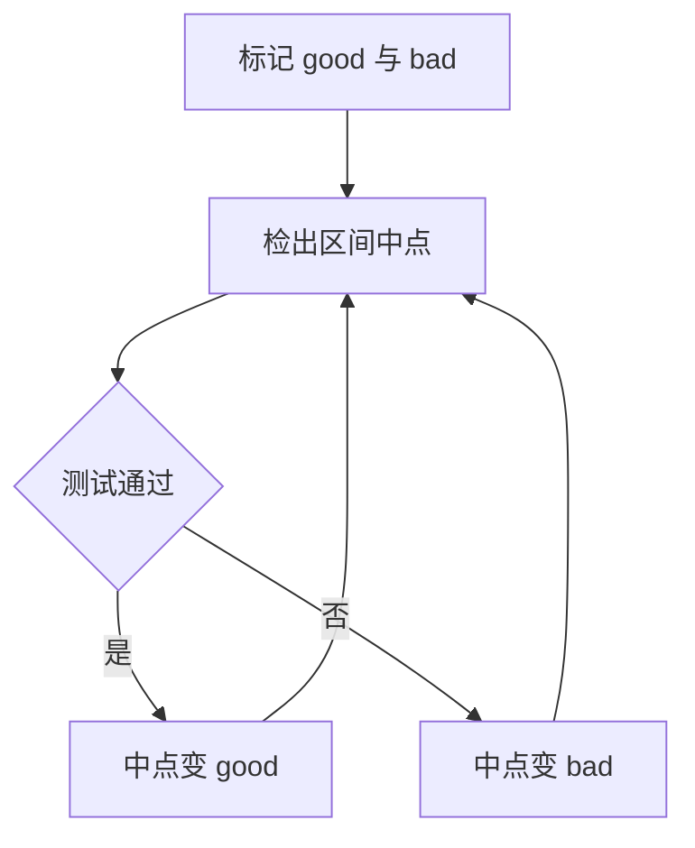

# 历史排查

排查历史的目标通常不是看提交，而是回答一个具体问题：这行谁改的、这功能哪次坏的、这段代码什么时候消失的。

## 看图与看文件

```bash
git log --all --graph --decorate --oneline
git log --oneline -- main.c
git log -p --follow src/app.py
```

带 `--graph` 才看得出分叉与合并，`--decorate` 标出分支和 tag 的位置。

```bash
git config --global alias.graph "log --all --graph --decorate --oneline"
```

`--follow` 能跨重命名追踪单个文件，代价是只能跟一个文件，且比普通 `log` 慢。

| 参数              | 作用                   |
| ----------------- | ---------------------- |
| `--author=名字`   | 按作者过滤             |
| `--since=2.weeks` | 按时间过滤             |
| `--grep=词`       | 搜提交消息             |
| `-S'字符串'`      | 搜增删过该字符串的提交 |
| `-G'正则'`        | 搜补丁内容匹配的提交   |
| `-L 10,20:file`   | 追某段行的演变         |

`-S` 叫 pickaxe，找的是「这个字符串出现次数变化过」的提交，比全文搜索更接近「谁引入的」。

## blame

`git blame file` 给每行标注最后改它的提交、作者和时间。它不是追责工具，而是定位改动的入口：拿到哈希再用 `git show` 看完整上下文。

```bash
git blame -L 40,60 src/app.py
git blame -w src/app.py        # 忽略空白改动
git blame -C -C src/app.py     # 追踪跨文件复制
```

格式化、缩进调整会把大量行算到某次无关提交头上，`-w` 能过滤掉这种情况。整文件重排之后 blame 基本失效，只能靠 `git log -S` 反查。

## 二分定位回归

`git bisect` 在 good 与 bad 之间做二分，提交数的对数次检出就能定位第一个坏提交。

```bash
git bisect start
git bisect bad                 # 当前版本有问题
git bisect good v1.2.0         # 这个 tag 正常
git bisect run ./test.sh       # 自动跑，退出码 0 算好
git bisect reset
```



手工标记时每一步都要 `git bisect good` 或 `bad`，脚本化之后 `run` 会自己走完全程。测试脚本退出码 125 表示跳过当前提交。

## 比较与回溯

```bash
git diff HEAD~3..HEAD -- src/
git diff main...feature        # 从共同祖先到 feature
git show v1.0:config.yml       # 读旧版本的文件
git rev-list --count HEAD
git shortlog -sn --no-merges
```

两个点与三个点的区别常被忽略：`A..B` 比较两端快照，`A...B` 从共同祖先比到 B，后者才是「这条分支相对主线改了什么」。

`git show <rev>:<path>` 直接把历史版本的文件打到 stdout，配合 `> file` 就能还原某个文件而不用切分支。

## 延伸：`git log -L` 的用法

`git log -L 10,20:file` 追踪第 10 到 20 行的演变，输出等价于对这一段的补丁历史。换成 `-L :<函数名>:file` 可以按函数定位，Git 用内置规则识别函数边界，也可由 `diff.<driver>.funcname` 自定义。
