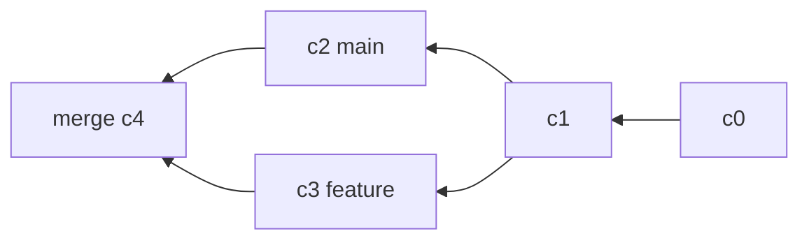

# 合并与冲突

合并问的是一句话：两条分支各自改了哪些内容，能不能拼成一个一致的快照。能拼就自动，拼不了才让人裁决。

## 快进与三方合并

目标分支自共同祖先以来没有新提交时，Git 只需把指针前移，这叫 fast-forward，不会产生合并提交。两边都动过，才需要真正的三方合并。

```bash
git switch main
git merge feature          # 能快进就快进
git merge --no-ff feature  # 保留分支形状，强制合并提交
git merge-base main feature
```

`--no-ff` 即使可以快进，也留下一个合并节点，让「这个特性从哪里进来」在图上可见。



三方指共同祖先、当前分支末端、待合入分支末端。Git 分别对比前后两份与祖先的差异，只有两边改了同一处才报冲突。合并提交的第一个 parent 始终是当前分支，`git revert -m 1` 就依赖这个约定。

## 冲突长什么样

冲突处会被插入三行标记，两侧内容原样保留：

| 标记            | 含义             |
| --------------- | ---------------- |
| `<<<<<<< HEAD`  | 当前分支版本开始 |
| `=======`       | 两侧分界         |
| `>>>>>>> salty` | 对方版本结束     |

解决方式是手工留下想要的内容，删掉三行标记，然后 `git add` 该文件并提交。冲突期间索引里同时保存 base、ours、theirs 三份版本，`git checkout --ours` 取的就是其中的 ours。

解决时的常用命令：

| 命令                           | 作用                 |
| ------------------------------ | -------------------- |
| `git status`                   | 列出未解决的冲突     |
| `git diff`                     | 显示合并式差异       |
| `git checkout --ours <file>`   | 取当前分支版本       |
| `git checkout --theirs <file>` | 取对方版本           |
| `git add <file>`               | 标记已解决           |
| `git log --merge`              | 列出与冲突相关的提交 |
| `git merge --continue`         | 收尾提交             |
| `git merge --abort`            | 回到合并前状态       |

## 解决顺序

1. `git status` 找出冲突文件
2. 打开文件，逐个 hunk 决定去留
3. 删干净 `<<<<<<<`、`=======`、`>>>>>>>`
4. `git add` 标记，编译或跑测试确认
5. `git commit` 完成合并

`git mergetool` 可以调出 vimdiff 或图形工具，三栏对比省去来回翻文件。配置 `merge.tool` 后每遇到一个冲突文件会自动打开。

冲突标记删错、括号少一半这类问题，编译器比人眼可靠。

## 延伸：ours 与 theirs 会反过来

在 `rebase` 过程中，`--ours` 指变基的基底，`--theirs` 指被你重放的提交，与直觉相反。原因是变基在逐个重放提交，Git 认为「当前所在」是基底那一侧。

`git rerere`（reuse recorded resolution）会记录你解决过的冲突，下次遇到相同片段自动套用。长命分支反复变基时开启 `rerere.enabled` 能省大量重复劳动。
