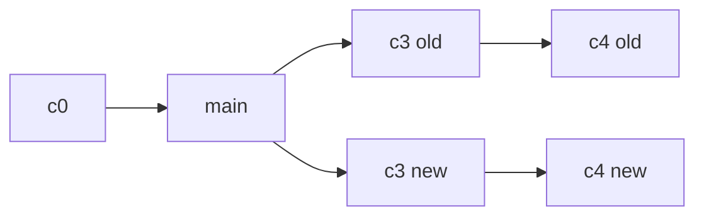

# 变基与重写历史

变基把一串提交摘下来，逐个重放到新的基底上。历史因此变直，但每个提交都换了身份。

## 重放的机制

`git rebase main` 在当前分支上执行：找到与 main 的共同祖先，把祖先之后的提交逐个应用到 main 末端。每应用一个就生成一个新提交，父节点不同，哈希必然不同。

```bash
git switch feature
git rebase main
# 冲突时
git rebase --continue
git rebase --abort
git rebase --skip
```

冲突可能出现在每一个被重放的提交上，不像合并只有一次。提交越多，变基过程越琐碎，这是它比合并麻烦的地方。



旧提交 `c3`、`c4` 并没有消失，只是不再被分支引用，仍可从 `reflog` 找回。变基、合并、`reset` 还会把操作前的位置写进 `ORIG_HEAD`，`git reset --hard ORIG_HEAD` 是最快的反悔方式。

## 合并还是变基

|          | merge              | rebase             |
| -------- | ------------------ | ------------------ |
| 历史形状 | 保留分叉与合并节点 | 拉成直线           |
| 提交哈希 | 不变               | 全部重算           |
| 冲突次数 | 一次解决全部       | 每个提交各一次     |
| 适用场景 | 公共分支、已推送   | 本地整理、同步上游 |

判断标准只有一条：这段历史有没有别人依赖。已推送的公共分支不要变基，否则每个人都要处理分叉的历史。

## 交互式整理

```bash
git rebase -i HEAD~3
```

编辑器里列出最近三个提交，每行前的动作决定命运：

| 动作     | 效果                 |
| -------- | -------------------- |
| `pick`   | 保留                 |
| `reword` | 保留内容，改消息     |
| `edit`   | 停下来修改内容       |
| `squash` | 并入上一个，合并消息 |
| `fixup`  | 并入上一个，丢弃消息 |
| `drop`   | 删除                 |

`git commit --fixup=<rev>` 造一个专门用来合并的提交，再 `git rebase -i --autosquash` 会自动排好顺序并标成 `fixup`。

`git rebase --onto main old-base feature` 把 feature 上 `old-base` 之后的提交搬到 main，适合从一个错误的分支上切出来。

## 强制推送的边界

改写历史后本地与远端分叉，普通 `push` 会被拒绝。`--force` 直接覆盖，可能抹掉别人的提交；`--force-with-lease` 要求远端仍停在你上次看到的位置，别人推过就失败。

```bash
git push --force-with-lease origin feature
```

`git cherry-pick <rev>` 是更小的重写工具：只把一个提交的改动复制到当前分支。它在原分支留下原提交，在新分支产生新哈希，适合把修好的补丁搬回发布分支。
