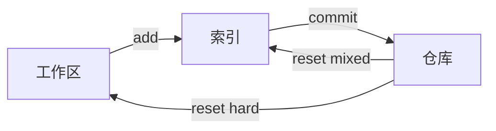

# 撤销与恢复

撤销先要问清楚三件事：撤的是工作区、索引，还是已经提交的历史；这段历史有没有推送；别人有没有基于它工作。

## 三个层次

| 命令                                 | 动工作区 | 动索引 | 动 `HEAD`    | 典型用途               |
| ------------------------------------ | -------- | ------ | ------------ | ---------------------- |
| `git restore <file>`                 | 是       | 否     | 否           | 丢弃未暂存的修改       |
| `git restore --staged <file>`        | 否       | 是     | 否           | 取消暂存               |
| `git restore --source=HEAD~1 <file>` | 是       | 否     | 否           | 取旧版本覆盖           |
| `git reset --soft HEAD~1`            | 否       | 否     | 是           | 撤销提交，改动留在索引 |
| `git reset HEAD~1`                   | 否       | 是     | 是           | 撤销提交并取消暂存     |
| `git reset --hard HEAD~1`            | 是       | 是     | 是           | 完全丢弃               |
| `git revert <rev>`                   | 是       | 是     | 是（新提交） | 反转已推送的改动       |

`--hard` 会直接覆盖未提交的修改，执行前先确认 `git status` 里没有想留的东西。它不会删掉提交对象，只会让引用后退。



## reset 与 revert

`reset` 移动分支指针，历史被改写，适合本地还没推送的提交。`revert` 生成一个内容相反的新提交，历史继续向前，适合公共分支。

```bash
git reset --soft HEAD~1
git commit -m "重新组织这次提交"

git revert 3f2a1c9
git revert --no-commit 3f2a1c9   # 先攒着不提交
git checkout HEAD~1 -- src/app.c # 旧写法，只取回这一个文件
```

撤销一个合并提交要指明主线：`git revert -m 1 <merge>`，`1` 表示保留第一个 parent。撤销后再想合回来，需要先 revert 那次 revert。

`reset` 不会删掉 reflog 条目，被移走的提交仍留在记录里；真正危险的只有 `--hard` 对工作区的覆盖。

## reflog 兜底

`HEAD` 每次移动都会记一条 reflog，默认保留 90 天。误执行 `reset --hard`、误删分支、变基出错，都能从这里找回。

```bash
git reflog
git reset --hard HEAD@{2}
git branch rescue 4d3c2b1
git fsck --lost-found
```

`reflog` 只记录本地操作，推送到远端的历史改写不在其中。提交对象只要还没被 `gc` 回收就仍在库里，`git fsck --lost-found` 能把悬空提交列出来。

## 暂存与清理

`git stash` 把工作区和索引的改动收进一个特殊引用，工作区恢复干净。

| 命令                    | 作用               |
| ----------------------- | ------------------ |
| `git stash push -m msg` | 存一份带说明的改动 |
| `git stash -u`          | 连未跟踪文件一起   |
| `git stash list`        | 列出所有条目       |
| `git stash pop`         | 取出并删除条目     |
| `git stash apply`       | 取出但保留条目     |
| `git stash drop`        | 删除指定条目       |

`git clean` 处理的是完全没被跟踪的文件，删掉就没有 reflog 可救。

```bash
git clean -n          # 预览
git clean -fd         # 删文件与目录
git clean -fdx        # 连 .gitignore 里的也删
```

`-n` 是唯一的安全网，养成先看后删的习惯。`-x` 会删掉构建产物和本地配置，多数时候并不想要。
