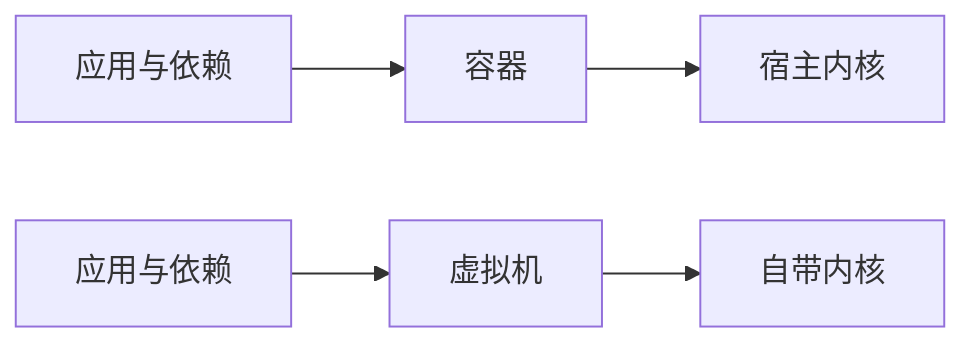

# 虚拟机与容器

依赖一旦伸到系统库和驱动，包管理器就管不着了。容器把应用连同整个文件系统一起打包，让「在我机器上能跑」这句话失去意义。

## 包管理器之外

科学计算和 AI 的项目常常要 CUDA、GPU 驱动；Web 服务要 `libpq`、`OpenSSL`；有些包要特定版本的编译器才能构建。这些东西装在系统目录里，影响整台机器，pip 和 npm 都碰不到。

传统解法是虚拟机：整台机器的抽象，自带操作系统内核，互不干扰，也互不共享。

| 层     | 例子                     | 谁负责装         |
| ------ | ------------------------ | ---------------- |
| 语言包 | `requests`、`numpy`      | pip、uv          |
| 系统库 | `libpq`、`OpenSSL`       | apt、dnf、brew   |
| 驱动   | NVIDIA 驱动、CUDA 运行时 | 手动或厂商脚本   |
| 内核   | 版本、模块、参数         | 系统，通常不敢动 |

越往下越难复制，也越容易成为「只有这台机器能跑」的原因。

## VM 与容器

|          | 虚拟机     | 容器               |
| -------- | ---------- | ------------------ |
| 隔离对象 | 整台计算机 | 进程与文件系统     |
| 内核     | 自带一份   | 共享宿主内核       |
| 启动     | 数十秒     | 毫秒级             |
| 体积     | GB 级      | 十 MB 到数百 MB    |
| 隔离强度 | 强         | 弱，共享内核攻击面 |



容器快是因为它不启动新内核，只把一组进程关进 namespace 并限制 cgroup 资源。代价是内核漏洞对所有人共享。

具体地说，namespace 隔离 PID、网络、挂载点、主机名，cgroup 限制 CPU、内存和 IO，根目录被换成镜像里那一份。进程还是宿主内核上的普通进程，`ps` 在宿主上看得见。

虚拟机没有被淘汰，因为它能做的事容器做不了：跑另一个操作系统、模拟 ARM 或 x86、给不可信代码一个真正独立的边界、在内核层做开发和调试。

## 镜像与 Dockerfile

```bash
docker run -it python:3.12 python
```

`image` 是打包好的模板，`container` 是它跑起来的实例，一个镜像可以起很多容器。镜像由 Dockerfile 逐条指令叠成层，每条 `FROM`、`RUN`、`COPY` 是一层，改了一层只需重建它和它之后的层。

Docker 只是最上层的工具，真正创建和运行容器的是 `containerd` 这类运行时，Kubernetes 用的也是同一套。

```dockerfile
FROM python:3.12-slim
COPY --from=ghcr.io/astral-sh/uv:latest /uv /usr/local/bin/uv
RUN apt-get update && \
    apt-get install -y --no-install-recommends gcc libpq-dev && \
    rm -rf /var/lib/apt/lists/*
WORKDIR /app
ENV PATH="/app/.venv/bin:$PATH"
COPY pyproject.toml uv.lock ./
RUN uv sync --locked --no-dev --no-install-project
COPY . .
RUN uv sync --locked --no-dev
```

几处设计值得记住：用 `slim` 而不是完整镜像；把 `apt-get update` 与 `install` 合成一条 `RUN` 并清掉 `/var/lib/apt/lists`，否则缓存留在层里；`uv` 从官方镜像直接 copy 二进制，这就是 builder 模式，不需要把编译工具链留在最终镜像里。

先 `COPY` 清单装依赖、再 `COPY` 源码，是为了让依赖层进缓存：改一行代码不会触发重装依赖。

构建上下文是 `docker build .` 里的那个目录，整个目录会被打包送给构建器。`.dockerignore` 因此不只是正确性问题，也直接决定构建快慢。

镜像体积影响部署时间：节点上没缓存时，拉一个 1.2 GB 的镜像比拉 80 MB 的慢出几十秒，扩容和故障转移都跟着变慢。层共享能缓解，前提是大家都基于同一个基础镜像。

## 平台与安全

- 镜像绑定架构：`linux/amd64` 的镜像在 Apple Silicon 上要靠模拟，慢一个数量级
- macOS 与 Windows 没有 Linux 内核，Docker 实际跑在一个轻量 VM 里，文件挂载有额外开销
- 默认以 root 运行，被攻破就是容器内 root，加 `USER` 或 `docker run --user`
- 密钥写进 `RUN` 或 `ENV` 会永久留在层历史里，`docker history` 能看到，删掉也没用
- `.dockerignore` 排除 `.git`、`node_modules`、`.env`，否则既慢又可能泄露
- 构建产物和源码分两个阶段，多阶段构建只把最后一阶段拷出来
- 多架构镜像用 `docker buildx build --platform linux/amd64,linux/arm64` 一次出两套，推到 registry 后由 manifest 按机器自动分发
- 行为不对时先 `docker logs`，再 `docker exec -it <id> sh` 进去看现场，别在宿主上猜

容器的隔离是「够用」而不是「安全边界」，多租户环境里跑不可信代码，虚拟机仍然是更稳的选择。

## 什么时候别用容器

需要内核模块、直接访问 GPU 设备、跑桌面 GUI、对 IO 延迟极度敏感的场景，容器不是好的抽象层。它解决的是「把用户态的文件系统搬过去」，解决不了「换一台机器就换一套内核」。
