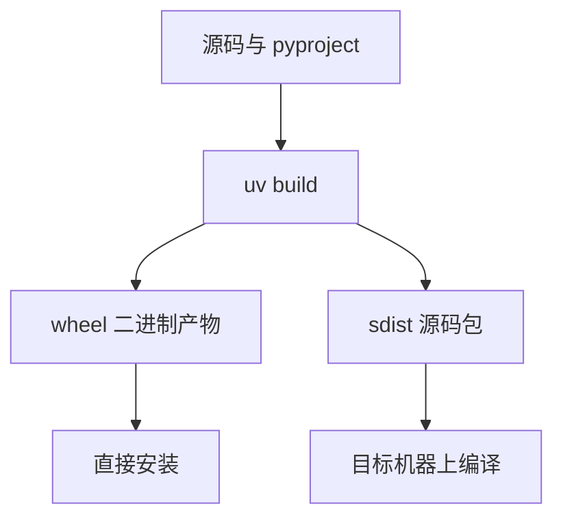

# 构建产物与打包

代码能在项目目录里 `import`，只是因为当前目录恰好在搜索路径上。打包就是把代码搬到解释器一定会查找的位置，并说明它依赖什么。

## 源码不是产物

```bash
$ cat greet.py
def greet(name):
    print(f"Hello, {name}!")

$ python -c "from greet import greet; greet('World')"
Hello, World!

$ cd /tmp
$ python -c "from greet import greet; greet('World')"
ModuleNotFoundError: No module named 'greet'
```

Python 只在这几处找模块：脚本所在目录（交互式下是当前目录）、`sys.path` 里的路径、`PYTHONPATH` 追加的目录、已安装包的 `site-packages`。换个工作目录，第一项就失效了。

| 交付对象   | 典型产物               | 使用方式                  |
| ---------- | ---------------------- | ------------------------- |
| 库         | wheel                  | `pip install` 后被 import |
| 命令行工具 | wheel + entry point    | 装完直接敲命令            |
| Web 服务   | 容器镜像               | 部署到服务器运行          |
| 系统工具   | `.deb`、`.rpm`、二进制 | 包管理器安装              |

四类对象的生命周期差别很大。库被别处引用，装一次可能几年不动；命令行工具跟着用户的手动升级走；Web 服务只要进程不死就在运行，回滚窗口以秒计。

## 清单文件

产物由源码加一份清单构建出来。现代 Python 用 `pyproject.toml`，`setup.py` 和手写 `requirements.txt` 属于旧路径。

```toml
[project]
name = "greeting"
version = "0.1.0"
description = "A simple greeting library"
dependencies = ["typer>=0.9"]

[project.scripts]
greet = "greeting:cli"

[build-system]
requires = ["setuptools>=61.0"]
build-backend = "setuptools.build_meta"
```

`dependencies` 是运行期依赖，装包的人会连带装上。`[build-system].requires` 是构建时依赖，只在从源码构建时进临时环境，两者不要混。`[project.scripts]` 声明 `greet` 这个命令，真实入口是模块里的 `cli` 函数。`name` 是发布到索引上的名字，与导入时的模块名可以不同；`requires-python` 声明最低解释器版本，装错版本时安装器会直接拒绝。

## 构建与检查

```bash
uv build
ls dist/
# greeting-0.1.0-py3-none-any.whl
# greeting-0.1.0.tar.gz

unzip -l dist/greeting-0.1.0-py3-none-any.whl
```

wheel 就是特定结构的 zip：代码放在顶层，元数据放在 `<name>-<version>.dist-info/` 里，`METADATA` 记录名称、版本和依赖，`RECORD` 记录每个文件的哈希与大小，卸载和校验都靠它。

| 文件名片段          | 含义                         |
| ------------------- | ---------------------------- |
| `greeting-0.1.0`    | 项目名与版本                 |
| `py3`               | 任意 Python 3 解释器         |
| `none`              | 不含 C 扩展，无需 ABI 匹配   |
| `any`               | 与操作系统、架构无关         |
| `cp312-cp312`       | CPython 3.12 专用 ABI        |
| `macosx_14_0_arm64` | macOS 14 以上、Apple Silicon |

`requests` 是 `py3-none-any`，谁的机器都能装；`numpy` 是 `cp312-cp312-macosx_14_0_arm64`，换平台就得另下一个轮子。



## 安装时发生了什么

拿到 wheel 之后，`pip` 只是解压并搬运：代码文件进 `site-packages/`，`dist-info/` 一起放进去，`RECORD` 里列出的路径成为「这个包装了哪些文件」的唯一依据。`pip uninstall` 就是照 `RECORD` 逐个删。

`[project.scripts]` 声明的命令会被翻译成一个可执行脚本，放在环境的 `bin/` 目录，内容大致是「用当前解释器调用 `greeting.cli`」。所以装完之后敲 `greet`，实际执行的是这个脚本，而不是模块本身。

```bash
pip show -f greeting      # 列出这个包装了哪些文件
pip install -e .          # 开发模式：改源码立即生效
```

开发时用 `pip install -e .`（或 `uv pip install -e .`）：它不复制文件，只在 `site-packages` 里放一个指向源码目录的链接，所以改代码不用重装。发布时仍然要构建正式 wheel，别把开发模式的路径当成交付物。

## 源码包与二进制包

sdist 是源码压缩包，装的时候需要在目标机器上编译，因此要求有编译器和 `[build-system]` 里声明的工具，大项目可能耗时很久。wheel 是别人已经编译好的产物，安装快，但必须与平台、架构、解释器版本匹配。

这也是 `ripgrep` 的 releases 页面列出 Linux x86_64、Linux ARM、macOS Intel、macOS Apple Silicon、Windows 一堆二进制的原因：Rust 没有跨平台的编译产物，只能按目标三元组各打一份。发布方不打，用户就得自己装 `cargo` 编译。

构建后端可以换：`setuptools`、`hatchling`、`poetry-core` 都实现同一份 PEP 517 接口，产出的 wheel 结构一致。换后端只影响构建行为和配置写法，不影响别人怎么安装。

不常用的依赖可以拆进 extras，别硬塞进 `dependencies`：

```toml
[project.optional-dependencies]
test = ["pytest>=8"]
docs = ["mkdocs>=1.6"]
```

装的时候写 `pip install 'greeting[test]'`。

## 打包检查清单

- `dist/` 里两个文件都在，版本号与 `pyproject.toml` 一致
- `unzip -l` 看不到测试、`.git`、`__pycache__`
- 在干净的虚拟环境里装一次，命令能跑
- `pip install --no-deps` 也能装进去，说明没有隐式依赖
- 长描述、license、`requires-python` 都填了，索引页面才不难看
