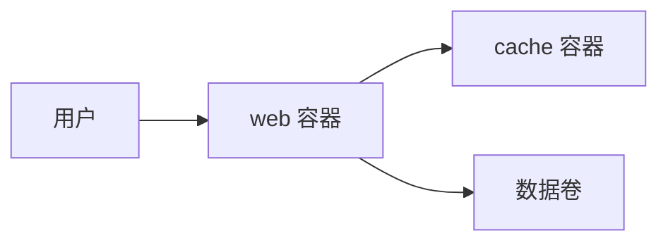

# 服务与编排

一个 Web 应用背后通常不止一个进程：数据库负责持久化，缓存负责提速，队列负责后台任务。逐个 `docker run` 起不来一个系统。

## 拆成服务

把 Redis 或 Memcached 编进应用依赖，理论上可行，实际上要把两套构建、两套升级节奏、两套依赖对齐，代价远高于直接跑官方镜像。

| 形态   | 优点                     | 代价                 |
| ------ | ------------------------ | -------------------- |
| 单体   | 部署简单，调用是本机函数 | 一处故障全站受影响   |
| 微服务 | 独立部署、独立扩容       | 网络、超时、版本兼容 |

拆开之后，组件之间只剩网络这一条路，通常走 HTTP + JSON。这条边界让每个服务可以用不同语言写、按自己的节奏发布，也让「调用失败」变成必须处理的常态。

拆之前先问：这两块会独立变化吗？共用同一张表、同一个事务的两段逻辑硬拆成两个服务，只会把本地事务换成分布式事务，换来一堆补偿代码。

服务边界通常沿数据边界划：谁拥有这张表，谁就是那个服务，别人只能通过 API 改它。共享数据库的两个服务，实际上是同一个服务被拆成了两个进程。

## Compose

Compose 用一个 YAML 文件声明所有服务，一条命令全部拉起。

```yaml
services:
  web:
    build: .
    ports:
      - '8080:8080'
    environment:
      - REDIS_URL=redis://cache:6379
    depends_on:
      - cache

  cache:
    image: redis:7-alpine
    volumes:
      - redis_data:/data

volumes:
  redis_data:
```



| 字段          | 作用                                |
| ------------- | ----------------------------------- |
| `build`       | 用当前目录的 Dockerfile 构建镜像    |
| `image`       | 直接拉现成镜像                      |
| `ports`       | 宿主端口映射到容器端口，`8080:8080` |
| `environment` | 注入环境变量                        |
| `depends_on`  | 只保证启动顺序，不保证服务可用      |
| `volumes`     | 命名卷，容器删了数据还在            |

`depends_on` 是最常见的误解来源：它等的是容器进程启动，不是应用准备好接受连接。真要等就配 `healthcheck`，再用长语法的 `condition: service_healthy`。

```yaml
services:
  web:
    depends_on:
      cache:
        condition: service_healthy
  cache:
    image: redis:7-alpine
    healthcheck:
      test: ['CMD', 'redis-cli', 'ping']
      interval: 5s
      retries: 5
```

健康检查是容器内执行的一条命令，返回 0 即视为健康。检查项要能代表真实可用性：`ping` 通只说明进程活着，不代表数据加载完了。

Compose 会建一个默认网络，服务名就是 DNS 名，所以 `web` 里连 `cache:6379` 就行，不用管容器 IP。容器内的 `localhost` 指容器自己，不是宿主。

它面向单机：跨机器的调度、网络和存储都不在能力范围内，这也是 Kubernetes 存在的理由。

## 上线运行

```bash
docker compose up -d
docker compose logs -f web
docker compose down
```

`-d` 让容器在后台跑，`logs -f` 跟日志。生产环境还要处理开机自启和崩溃重启：

```ini
[Unit]
Description=My Application
Requires=docker.service
After=docker.service

[Service]
Type=oneshot
RemainAfterExit=yes
WorkingDirectory=/opt/myapp
ExecStart=/usr/bin/docker compose up -d
ExecStop=/usr/bin/docker compose down

[Install]
WantedBy=multi-user.target
```

`Type=oneshot` 加 `RemainAfterExit=yes` 表示这条命令跑完就退出，但 systemd 仍认为服务在运行。之后 `systemctl start myapp`、`systemctl status myapp` 都能用。

这套写法适合一台机器的小规模部署：一个 compose 文件、一个 unit。机器挂了服务就挂，没有任何冗余，属于能接受停机时的选择。

单个容器的重启策略写在 compose 里：`restart: unless-stopped` 表示崩溃就重启，手动停下的不重启。

数据卷不等于备份。卷删了数据就没了，迁移机器也要单独搬，生产上的数据库还得有定期导出和恢复演练。

```bash
docker compose ps           # 每个服务的状态与端口
docker compose restart web  # 只重启一个服务
```

规模再大就要考虑跨机器调度、故障转移、滚动更新，这类需求交给 Kubernetes。它学习曲线陡、运维成本高。

## 服务间通话

```bash
curl -s http://localhost:8080/health
curl -X POST http://localhost:8080/items \
  -H 'content-type: application/json' \
  -d '{"name": "book"}'
```

调试服务时，`curl` 能把「应用坏了」和「网络坏了」分开：先打健康检查，再打业务接口，最后看日志。容器网络里则把 `localhost` 换成服务名。

跨进程调用有三个必设项：超时、重试、幂等。没有超时会把线程挂死，没有退避的重试会把下游打垮，不幂等的写操作重试一次就多一条数据。

排查时靠请求 id 串起来：入口生成一个，带进每个下游的 header 和日志，否则跨服务的错误只能靠时间戳猜。
