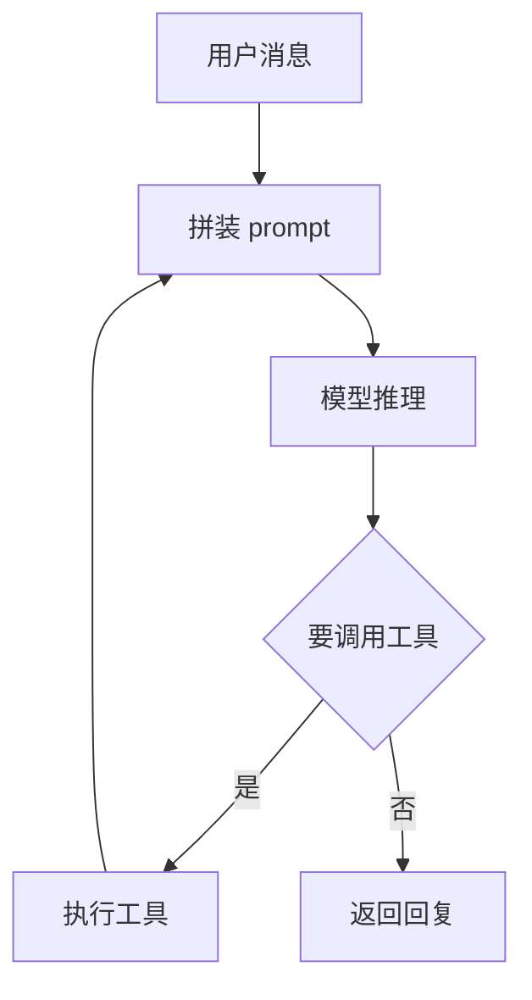

# Agent 的运行方式

Agent 不是一个更聪明的模型，而是「模型 + 工具 + 循环」：模型只输出 token，真正读文件、跑命令的是外面那层程序。

## 推理是在采样

LLM 建模的是「给定前文，下一个 token 是什么」的概率分布。每次生成都是从分布里采样，所以同一个 prompt 跑两遍可能得到不同结果，这也是并行跑多份有意义的原因。

同一条需求重试两次，本质就是重新采样——运气好一次就中，运气差越修越乱。模型没有记忆，全靠每轮重发历史：

- 多轮对话靠把全部历史重新拼进 prompt
- token 消耗大致随轮数平方增长
- 「它忘了」通常不是记性问题，是内容被挤出去了

| 概念             | 含义                            |
| ---------------- | ------------------------------- |
| `context window` | 单次请求输入加输出的 token 上限 |
| 采样             | 从概率分布里取下一个 token      |
| 温度             | 控制分布的平坦程度，越低越保守  |
| 知识截止         | 训练数据的时间边界，不认识新库  |

## Harness 的循环

`harness` 是包在模型外面的程序：拼 prompt、解析工具调用、执行工具、把结果塞回消息列表。工具调用不是魔法，就是模型输出了一段符合 schema 的 JSON。



一次工具调用就触发一次完整推理，所以「读十个文件」是十几次往返，慢和贵都出在这里。模型看到的只是工具返回的文本，返回被截断时它并不知道还有后半段。

工具 schema 本身也占窗口。挂五十个工具，模型既更容易选错，也更容易在无关工具上兜圈子。

- IDE 插件把编辑器缓冲区当上下文
- CLI agent 把工作目录当上下文

两种外壳跑的是同一套循环。

## 确认闸门

工具能造成真实破坏，所以默认配置下每次调用都要你点确认：改文件、跑命令、发请求。这个闸门由 harness 实现，不在模型里，意味着模型无法绕过它。

不同的调用风险差别很大。读文件、`rg` 搜索基本无害；`rm -rf`、`git push --force`、`curl ... | bash` 需要你真正看一眼参数。日常操作里最容易出问题的是后者被夹在一串看起来正常的命令中。

## 为什么它自信地错

模型没有「我不确定」的内部开关。它写出的错误结论和正确结论一样流畅，因为生成过程里没有执行环境去核对。工具给了它核对的手段，但它不会自动使用，所以提示里要写死验收命令。

另一个后果是它会顺着你的假设走。你说「这个 bug 是不是并发引起的」，它很容易编出一套并发解释。换成中性问法——「可能的原因有哪些，各自的证据是什么」——得到的信息可靠得多。

## 最小实现

去掉 UI、权限和重试，核心循环只有几十行；连工具 schema、错误处理和重试一起算，一个能用的工具调用 agent 大约 200 行。理解这一段，就能解释它的大部分行为。

```python
messages = [{"role": "system", "content": SYSTEM_PROMPT}]

while True:
    reply = llm(messages, tools=TOOLS)      # 一次推理
    messages.append(reply)

    if not reply.tool_calls:                # 不再调用工具就结束
        break

    for call in reply.tool_calls:
        result = run_tool(call.name, call.args)
        messages.append({"role": "tool",
                         "name": call.name,
                         "content": result})
```

| 角色        | 谁产生  | 内容                    |
| ----------- | ------- | ----------------------- |
| `system`    | harness | 规则、`AGENTS.md` 全文  |
| `user`      | 你      | 需求、纠错、补充信息    |
| `assistant` | 模型    | 文本、工具调用参数      |
| `tool`      | harness | 工具输出，通常是 stdout |

## 成本与延迟

工具返回的每个字节都会在后续每一轮被重新发送，一个巨大的 `cat` 输出会把整段对话拖慢。给 agent 的默认建议是「用 `rg` 定位再读区间」，而不是读整个文件。

几个成本细节：

- token 不是字符，中文与代码切得更碎
- 历史前缀变动会让 prompt 缓存失效，`AGENTS.md` 频繁改动等于重付输入
- 长会话的边际成本随轮数上升，早期少塞一点，后面省很多
