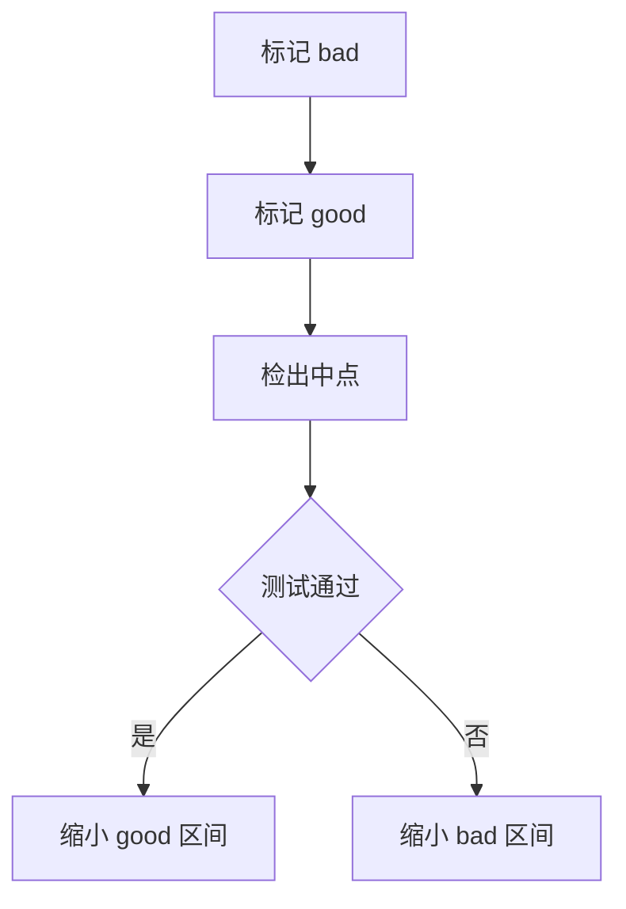

# 提交信息记录决策

`git log` 是跟着代码走得最久的设计文档，但大多数提交信息只复述了 diff。

## diff 已经说了 what

打开 `git show` 就能看到改了哪些行，提交信息再写「修改了解析逻辑」等于什么都没说。真正会丢的是 why：什么问题逼出了这次改动、考虑过哪些替代方案、有什么代价。

| 读者的问题   | 弱        | 强                               |
| ------------ | --------- | -------------------------------- |
| 改了什么     | `fix bug` | `修复空配置导致的启动崩溃`       |
| 为什么现在改 | 无        | 线上每小时触发一次，影响支付回调 |
| 考虑过什么   | 无        | 试过重试，但会掩盖配置错误       |
| 有什么影响   | 无        | 旧配置需要迁移，启动会多一次校验 |

复述 diff 还有一个副作用：代码一改，提交信息里的细节就过时，而它无法被更新。写决策不会过时，决策只在被新决策推翻时才失效。

`git blame` 把每一行回溯到引入它的提交，提交信息就是那里唯一的上下文。写得含糊，回溯到一半就断了。

## Problem Solution Implications

复杂改动用三段结构：什么问题迫使改动、改了什么、带来什么后果。最后一段最容易被省略，也最有用，它把「有意为之的取舍」和「没想到的缺陷」区分开。反直觉的行为值得单独点出，否则 reviewer 会以为是遗漏。

```text
fix: 避免并发写入覆盖配置

问题：两个进程同时写 config.json 时，后写者会覆盖前者刚写入的字段。
方案：读改写放进同一把 flock，锁文件放在 XDG_RUNTIME_DIR。
影响：Windows 没有 flock，回退到独占创建 lockfile，失败重试一次。
```

结构不是模板，长度随复杂度变化。一个拼写修复只需要 subject，一个调了三小时的竞态修复值得写满三段。

## 拆分提交

一个提交应当能被独立理解、独立回滚。重构和新功能混在一起，reviewer 无法判断行为变化来自哪里，回滚也会带走不相关的东西。

```bash
git add -p                     # 按 hunk 挑选
git add -N new_file.py         # 让新文件进入 diff 再拆
git commit --fixup=<sha>       # 标记为补丁
git rebase -i --autosquash     # 自动归位
git diff --staged              # 提交前自查
```



每个提交都能构建、测试通过，`git bisect` 才能定位到具体变更。提交历史脏的项目，二分出来的往往是一团混合改动。

如果能用测试复现问题，`git bisect run ./check.sh` 会把每次检出交给脚本判定，自动跑到第一个坏提交，不用一个个手动标 good 和 bad。

## 别让模型替你回忆

只把 diff 交给模型，它看到的和你同事一样少，写出来必然偏描述性。

- 在同一个会话里让它写，上下文最全
- 明确要求它先提问，补齐动机和取舍
- 把失败的尝试和约束一起贴进对话
- 生成后自己改一遍，删掉套话

Conventional Commits 用 `feat:`、`fix:`、`docs:` 之类的前缀，方便生成 changelog 和推断版本号，但它不替代正文里的 why。前缀说明类别，正文说明理由。

改写提交序列之后，用 `git range-diff origin/main pr-v1 pr-v2` 比较两版补丁，确认没有在变基时丢掉改动。

## 提交信息不是日记

不是每次提交都值得写三行。改一个错别字、调一个日志级别，subject 足够；硬凑模板反而让读者跳过所有正文。

判断标准是「六个月后是否有人需要知道原因」。需要，就写清约束和取舍；不需要，就把这一行写准。模板服务于沟通，不是提交的准入条件。

## subject 的写法

subject 用祈使句，说明这次改动带来的结果，而不是你做过的事。「修复空配置崩溃」比「修复了一个 bug」具体，「避免重复写入」比「修改 write 函数」更接近读者关心的问题。

- 长度控制在五十字符左右，超出说明改动不够聚焦
- 结尾不加句号，和 `git log --oneline` 的排版一致
- 不在 subject 里写文件名，diff 里看得到
- 需要背景时把细节放进 body，不要挤进一行
- 正文每行控制在七十二字符，终端里不用折行
- 关联 issue 用 `Closes #123`，合并时自动关闭

有些团队用 Conventional Commits 约束前缀，有些要求关联 issue 编号，规则不同但目标一致：让 `git log` 在不打开 diff 的情况下也能读。

方便检索是额外的收益。按 `fix:` 过滤、按模块名 grep，都依赖 subject 里出现稳定的词；写成「update」「minor changes」的提交，事后既搜不到也读不懂。
