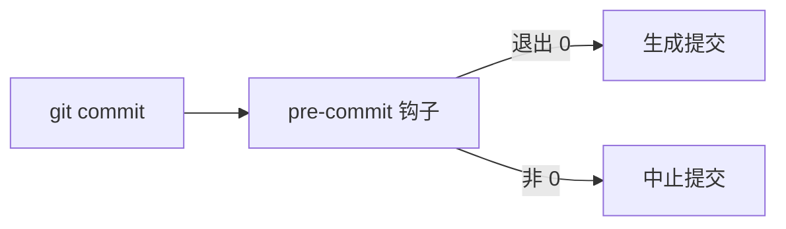

# 提交前钩子

钩子是 Git 在特定动作前后调用的脚本，跑在本地，出错就中止这个动作。最常用的是 `pre-commit`。

## 钩子怎么工作



Git 只负责调用脚本，脚本内容随意。它继承当前环境，能看到暂存区和工作区，也能拿到提交信息文件路径。脚本退出 0 就继续，非 0 就停。

钩子的运行环境有几个特点：

- `stdin`、`stdout` 直接连终端
- 环境变量里有 `GIT_DIR`、`GIT_INDEX_FILE` 这些路径
- 当前目录不保证是仓库根，先 `cd` 到 `git rev-parse --show-toplevel`

钩子不是版本库的一部分。`.git/hooks` 不会随 `git clone` 下发，新同事默认没有保护。`core.hooksPath` 可以把它指向仓库内的目录，让钩子跟着代码走：

```bash
git config core.hooksPath .githooks
```

代价是这条配置本身也要每人执行一次，通常写进项目的初始化脚本或 `README`。

## 手写一个钩子

```bash
#!/usr/bin/env bash
set -euo pipefail

ruff format --check .
ruff check .
```

文件放 `.git/hooks/pre-commit`，加执行位 `chmod +x`。任何一步返回非零，提交就停在那里。`set -euo pipefail` 保证中途失败不会被后面的命令掩盖。

写钩子时有两条底线：

- 只调用已经装好的工具，不要临时 `npm install` 或 `pip install`
- 单次运行控制在几秒内，否则人会开始绕过它

`git commit --no-verify` 跳过全部钩子。它存在是必要的：钩子误判时总得有逃生通道。但这也意味着钩子只能防手滑，防不住故意，真正的关卡必须放在服务端。

## pre-commit 框架

手写钩子要自己管依赖、自己保证每个仓库一致。pre-commit 框架把这些收进一份配置。

```yaml
repos:
  - repo: https://github.com/astral-sh/ruff-pre-commit
    rev: v0.6.9
    hooks:
      - id: ruff
        args: [--fix]
      - id: ruff-format
  - repo: https://github.com/pre-commit/pre-commit-hooks
    rev: v4.6.0
    hooks:
      - id: trailing-whitespace
      - id: end-of-file-fixer
```

`pre-commit install` 把入口脚本写进 `.git/hooks/pre-commit`；之后每次提交，框架按配置逐个跑。`rev` 固定到 tag，用 `pre-commit autoupdate` 统一升级，避免不同机器装到不同版本。

| 命令                         | 作用               |
| ---------------------------- | ------------------ |
| `pre-commit run --all-files` | 对全仓库跑一遍     |
| `pre-commit run ruff`        | 只跑某个 hook      |
| `pre-commit autoupdate`      | 升级 hook 版本     |
| `pre-commit clean`           | 清掉缓存的虚拟环境 |

每个 hook 在自己的虚拟环境里装依赖，首次运行要建环境，之后走 `~/.cache/pre-commit`。想用本机已装好的工具，写 `language: system`，但这样就把「装依赖」的责任推给了每个人。

`args` 里的 `--fix` 很重要。钩子直接改文件比只报错友好：格式化器把文件改好，提交失败，你 `git add` 一下再提交就过了。

## 其它钩子

| 钩子         | 时机           | 典型用途                  |
| ------------ | -------------- | ------------------------- |
| `pre-commit` | 生成提交对象前 | 格式化、lint、密钥扫描    |
| `commit-msg` | 提交信息写好后 | 校验 Conventional Commits |
| `pre-push`   | 推送前         | 跑完整测试、类型检查      |
| `post-merge` | 合并完成后     | 装依赖、跑迁移            |

`commit-msg` 拿到的是提交信息文件路径，参数是 `$1`。校验失败就以非零退出，提交不会生成。

钩子按固定顺序执行：

- `pre-commit` 先跑，失败就不会走到 `commit-msg`
- `commit-msg` 失败也不会进 `pre-push`

离线或 CI 环境里，首次运行会去 clone 每个 hook 仓库。提前执行 `pre-commit install --install-hooks` 把环境装好，能避免第一次提交卡在网络上。

## 边界与局限

pre-commit 只检查暂存的文件。工作区里没 `git add` 的改动不会被看到，所以它通过不代表工作区是干净的。

几个机制细节值得知道：

- 框架会把未暂存的改动临时 stash 起来，跑完再还原；编辑器同时自动保存时可能冲突
- 钩子改完文件后忘了重新 `git add`，提交进去的仍是旧内容
- 图形界面的 Git 客户端不继承 `~/.zshrc` 里的 `PATH`，钩子会报「command not found」

慢的检查应该挪到 `pre-push` 或 CI。钩子只放格式化、lint、拼写、大文件与私钥检测这类秒级任务。

钩子能做的事有限，边界要清楚：

- 它只看机械规则，看不到设计问题，更判断不了这段逻辑该不该存在
- 它可被跳过、可被卸载、可在没装依赖的机器上失效
- 它和 CI 都要能在本地一条命令复现，否则失败信息只能靠猜

CI 才是唯一无法绕过的关卡。
